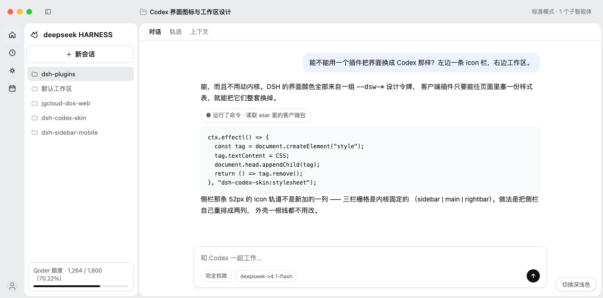
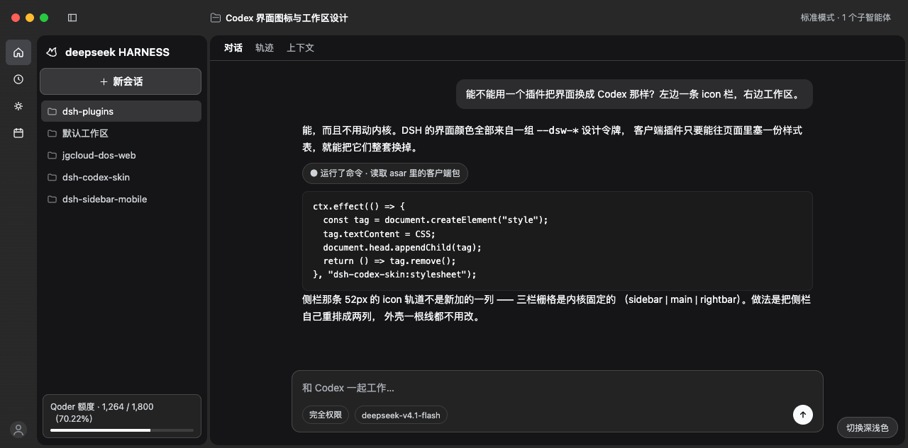

# dsh-shell-kit

DeepSeek Harness 的**桌面外壳定制工具箱**。现在装了两件东西：

1. **卡片式三栏布局**（皮肤）：侧栏从「一条长侧栏」拆成「52px 图标栏 + 240px 定宽工作区面板」，工作区与会话区各自是一张白色圆角卡片，macOS 顶部有一条定高的通栏色带，与最左图标栏连成一片。
2. **开机动画**：启动时鲸鱼被一笔描边画出来、再填成实心，字标与进度线随后出现，就绪后整层让位给 App。

**配色一个色号都不新增**——所有颜色直接引用 DSH 自己的 `--dsw-*` 令牌，浅色/深色、跟随系统、换第三方主题都自动跟随。

**零内核改动**：不替换任何内置包。皮肤靠一份注入的样式表，开机动画靠 Host 侧 `webserver/index-inject` 注入 `style + html + script` 三行。

> 旧名 `dsh-codex-skin` 已废弃：这个包早就不只是"Codex 风格皮肤"了，后面还要往里放更多外壳能力，所以改成 `dsh-shell-kit`（`cordis.patch.yml` 里的 id 也相应改成 `shell-kit`）。装过的 profile 需要把 bundles / dependencies / patch 行里的旧名换成新名，见 §五。





---

## 一、结论：能做，但边界要说清

| | 能不能 | 说明 |
|---|---|---|
| 圆角 / 密度 / 布局 | ✅ 能 | 全部走 `--dsw-*` 设计令牌与 `data-slot` 锚点 |
| 换成另一套配色 | ✅ 能，但本皮肤选择不改 | 令牌可整体重铺；本皮肤刻意沿用 DSH 原色 |
| 侧栏变成「icon rail + 面板」两列 | ✅ 能 | 在**现有侧栏内部**用 CSS grid 重排，外壳一根线不动 |
| 组件级微调（标题字号、分隔线、行高） | ✅ 能 | 靠 `data-slot` 与 `[class*="_local"]` 定位 |
| 真的「新增一列」的外壳 | ❌ 不能 | 三栏栅格 `sidebar \| main \| rightbar` 是内核固定的 |
| 复用 macOS 折叠态那条 56px rail | ❌ 不能 | macOS 桌面折叠是 **0px**，56px 只存在于 web / Windows titlebar 分支 |
| 图标栏带 tooltip、新增按钮 | ⚠️ 要注册组件 | 纯 CSS 做不到；需用 slots 接管 `sidebar` 座位 |
| 改信息架构（Codex 的「项目 / 最近」） | ❌ 不属于换肤 | 那是功能，不是样式 |

一句话：**换皮可以做得很彻底；换骨架不行。**

---

## 二、为什么能（三条接缝，都有出处）

### 1) 设计令牌 —— 主杠杆

DSH 客户端组件的样式全部消费 `--dsw-*`：

```css
.PIRFFq_sidebarCol { background: var(--dsw-specific-sidebar-fill); }
.PIRFFq_centerCol  { border-left: .5px solid var(--dsw-alias-border-l3); }
```

而 107 个 `--dsw-alias-*` 几乎全部由 `--dsw-static-neutral-bluish-*` 这一条单调节出来
（`bg-base = bluish-00`、`sidebar-fill = bluish-50`、`label-secondary = bluish-600` …）。
所以**要换配色只需重铺这一条阶**——但本皮肤故意不铺：它只**消费**这些令牌。

唯一需要「新颜色」的地方是 rail（平台没有「比面板深一档」这个概念），
用 `color-mix` 从平台令牌现算，仍然不是新色号：

```css
--cx-rail: color-mix(in srgb, var(--dsw-specific-sidebar-fill),
                     var(--dsw-alias-label-primary) 6%);
/* 浅色：bluish-50 压暗 6% ≈ bluish-75；深色：bluish-900 提亮 6% ≈ bluish-875 */
```

令牌声明在 `@deepseek-ai/dsh-client-ui-theme/lib/client.js` 的
`design_platform_css_default`（static 色阶 + alias 的 light/dark 映射）与
`base_css_default`（`:root` 里的圆角）里 —— 都是普通样式表规则，
插件样式后注入、用 `html body`（0,0,2）/ `html:root`（0,1,1）就能压过，
**不需要 `!important`**。

> 关键前提：内置主题的 `tokens` 是 `Object.freeze({})` —— 平台默认不会往 `body`
> 写任何内联 `--dsw-*`。如果哪天装了会注册 override 的第三方主题，令牌会变成
> `body` 上的内联 style，那时才需要改用 `ctx.theme.overrideTokens(pkg, {...})`
> 参与叠加（见「已知边界」）。

### 2) CSS 注入通道 —— 插件能自己塞样式

DSH 每个客户端包都不走 CSS loader，而是自己建 `<style>`：

```js
const tag = document.createElement("style");
tag.dataset.plugin = PKG;
tag.dataset.pluginCss = `${PKG}/${file}.module.css`;
tag.textContent = css;                 // 构建期内联的字符串
document.head.appendChild(tag);        // 先按 data-plugin-css 去重
```

插件照抄同一套即可。样式标签按 document order 生效，后注入的自然压过前面的。

### 3) 槽位与选择器 —— 定位组件内部（本插件的次级手段）

组件类名带每版本哈希前缀（`kB3qhq_root`、`PIRFFq_sidebarCol`），不能硬编码。
但有两类稳定锚点：

- `<div data-slot="<seat>" style="display:contents">` —— 槽位包裹层，名字是公开契约；
- `[class*="_localName"]` —— 子串选择器，跨版本仍能命中哈希类名。

⚠️ 一定要 `>` 直连或加作用域：`_root` / `_iconButton` / `_rail` 这些局部名在
多个包里重名（WorkspaceBrowser 也有 `_root`、`_rail`、`_iconButton`），
宽泛的后代选择器会误伤。

---

## 三、插件结构

```
dsh-shell-kit/
├─ package.json            dsh.bundle.patch + dsh.client{platform:"web", immediately:true}
├─ cordis.patch.yml        Host 侧那一行（insert, id: shell-kit）
├─ index.js                Host 半个：订阅 webserver/index-inject，注入开机画面三行
├─ host/                   开机动画资源（由 index.js 读取后内联进 index.html）
│  ├─ boot.css             动画样式（纯 CSS，进 <head>）
│  ├─ boot.html            动画结构（内联鲸鱼 SVG，紧随 <body>）
│  └─ boot.js              计时与交接（检测应用挂载 → 淡出）
├─ src/client/parts/       Client 源码片段（**按文件名排序拼接**，无 import/export）
│  ├─ 00-core.jsx          PKG / React / CSS 占位符 / installStylesheet
│  ├─ 10-rail.jsx          rail 图标 tooltip、rail 最上面的「工作区」入口
│  ├─ 20-band.jsx          标题栏带高度测量（installBandHeight）
│  ├─ 30-sidebar.jsx       侧栏列宽锁定 + 「收工作区」折叠
│  ├─ 40-archived.jsx      设置页「已归档的聊天」
│  └─ 99-entry.jsx         apply() 装配 + __ModuleLoader__ 注册
├─ src/client/styles/      皮肤样式（**同样按文件名排序拼接**，顺序即层叠顺序）
│  ├─ 10-tokens.css        层 1：--cx-* 别名 + 平台变量组（唯一放平台差异的地方）
│  ├─ 20-shell.css         层 2：外壳色带 / 三列 / 中央白卡 / 会话卡
│  ├─ 30-sidebar.css       层 3：rail 52 + 面板卡 240 / rail-only / 底部两格
│  ├─ 40-rightbar.css      右侧边栏 = 标题栏 + 白卡片
│  └─ 50-archived.css      设置页「已归档的聊天」
├─ src/client/assets/      SVG 资源（构建期内联回字符串，运行时仍是 data-URI，零请求）
│  ├─ folder.svg           会话标题前的文件夹图标（CSS mask-image 用）
│  └─ house.svg            rail 顶部「工作区」入口（JS 内联 SVG 用）
│                          注：设置页那两个图标**故意**留在 40-archived.jsx 里 —— 它们是
│                          React 组件、靠 className + `stroke="currentColor"` 继承样式，
│                          外置成文件必须再套一层 wrapper，反而破坏样式契约。
├─ scripts/build-client.mjs  片段拼接 + JSX 转译 + CSS/SVG 内联 → lib/client.js
├─ scripts/verify-client.mjs 产物自检：门禁/平台变量/几何/JS 谓词共 23 项断言
├─ lib/client.js           产物（提交进仓库）
├─ docs/boot/              开机动画的设计稿与演示（demo-boot.html 可直接打开）
└─ preview/index.html      静态预览：真实组件 CSS + 本皮肤
```

**为什么 Host 半个是空的**：DSH 的 bundle 是「一个包 = 一个 Host 插件 + 可选一个
Client 插件」，`dsh.profile.bundles` 里写的是包名，加载器要靠 Host 入口在
cordis 图里挂一行。皮肤不带配置、不注册工具、不碰服务，所以是空实现。

**为什么 CSS 要构建期内联、JSX 要构建期转译**：客户端插件是经典脚本
（`__ModuleLoader__` 加载，`require` 由宿主注入），不能 import、不能运行时读文件，
也不会被任何 loader 处理 —— 所以 CSS 只能是字符串常量，JSX 必须在构建期变成
`React.createElement` 调用（`React` 由宿主在 factory 里注入）。

**为什么源码是「片段 + 数字前缀」而不是 ES 模块**：上面那条「不能 import」直接
排除了模块化的可能。于是把大文件按功能切成 `src/client/parts/NN-*.jsx` 与
`src/client/styles/NN-*.css`，构建脚本按文件名排序后**原样拼接**，再整体转译；
前缀数字就是执行 / 层叠顺序，加新文件时挑一个数字即可。收益纯粹是工程性的：
改侧栏只开 `30-sidebar.*`，改右侧栏只开 `40-rightbar.css`，不用在一千行里翻。
拆分本身经过「各段拼回去与原文逐字节相同」校验（改前改后产物正文 SHA 一致），
所以它不改变任何产物语义 —— 只是把文件切开。

---

## 三·五、启动画面（Host 侧注入）

### 为什么只能走 Host

Client 插件要等模块图装配完、浏览器拿到 bundle 之后才执行 —— 那时应用已经挂载，
开机画面早就过去了。Host 侧有一个 `webserver/index-inject` 表：订阅者往 table 里
push 行，宿主渲染 `index.html` 时按行拼进去（桌面端则通过 `dshDesktopBoot.ready()`
拿到同一份表再注入）。DSH 自己的主题引导也是这么干的。

行只有六种形态（`@deepseek-ai/dsh-host-webserver` 的 `renderRow`）：
`global` / `script` / `script-src` / `script-preload` / `style` / `html`。
本插件用其中三种：

| 行 | 落点 | 作用 |
| --- | --- | --- |
| `style` | `<head>` | 首屏前就生效，不闪白 |
| `html` | 紧随 `<body>` | 动画的 DOM（内联鲸鱼 SVG，无外部图片） |
| `script` | 紧随 `<body>` | 计时、检测应用挂载、淡出 |

### 动作与时间轴

```
0ms      极淡点阵淡入
110ms    一笔描线沿鲸鱼轮廓走（680ms）
780ms    轮廓画完，描线退场、实心填充淡入（400ms）
950ms    字标 DEEPSEEK HARNESS 浮现（520ms），字距 .46em → .3em
1700ms   字标 1.47s 落定、停一拍（≈230ms）→ 整层淡出 280ms → 移除
```

一句话原则：**画完 logo、亮出字标，正好是装配完成的时刻** —— 不用进度条去"撑"时长，
也不会出现"动画播完了还空等一拍"。

为此删掉的三样东西：

- **进度条**（168×3px 巡游条 + 就绪补满）：它是为了给 2.4s 的等待一个落点；
  现在画面自己就是落点，留着反而多一层噪音。
- **中心冷光晕**：纯白底上看起来像一块脏印（有截图对比），删。
- **字标里的 HARNESS 边框徽标**：收成一行 `DEEPSEEK HARNESS`，`HARNESS` 只弱化字重与颜色。

### 与 DSH 自带 loading 卡片的关系

DSH 自己在 `#root` 里也画一张 loading 卡片（`[data-dsh-boot]`，带进度弧）。
本插件**不替换它**，只是：

- 用 `[data-dsh-boot]{opacity:0}` 把它藏起来（它此时仍是"应用挂载完成"的信号）；
- 等应用外壳真的渲染出槽位（`[data-slot="sidebar"]` 或 `[class*="_frame"]`）后收场；
- 万一 10s 内都没挂载，`bail()` 会把自带卡片还回去并退出（`html[data-sk-boot-bailed]`），
  即"美化失败不劫持失败态"。

### 实测（临时 web profile，真机注入）

```
t0=90ms   mountedAt=333ms   closedAt=1701ms
```

即：画面 1.47s 落定、1.7s 收场，与应用可用的时刻基本重合（改前是 2.64s 才退场，
多出的那 0.95s 是纯粹的等待）；
`curl` 拿到的 `index.html` 里能看到 `data-sk-boot` / `sk-boot__trace` / `--dsh-boot-bg` 已被注入。

### 可调参数（都在 `host/boot.js` 顶部）

| 常量 | 默认 | 作用 |
| --- | --- | --- |
| `MIN_SHOW` | 1700 | 字标落定（1.47s）+ 停一拍（230ms），不够就等够再退 |
| `MAX_SHOW` | 10000 | 兜底：应用迟迟不 ready 也要收场 |
| `FADE` | 280 | 淡出时长 |

点任意处 / Esc / Space / Enter 都会立刻跳过。

---

## 三·六、设置页：已归档的聊天

设置里多了一页「已归档的聊天」（`settings.section` → `id: archived-chats`，`order: 20`，
排在「通用 0 / 模型 10 / 插件 15」之后），按项目分组列出所有已归档会话，支持搜索、
按项目筛选、单条「取消归档」和「全部取消归档」。

### 「删除」是怎么做出来的（内核没有这个接口）

参考图里有「删除 / 全部删除」，而 **DSH 内核就是没有删除会话的接口**：客户端
`ctx.workspaces` 只有 `create / rename / delete(删工作区) / archive / unarchive / pin / …`，
Host 的 `api-session-controller` 的 Remote 面里也没有 remove，`api-session/removed`
只是「会话被销毁」的通知。所以这一页的删除是**插件自己补的一条路**：

```
设置页「删除」 ──fetch──> 插件自己的 loopback HTTP 服务 ──rename──> 回收站目录
   （页面里带令牌）         （只绑 127.0.0.1、随机端口）      （同盘原子移动）
```

三件事解释一下：

1. **为什么不用 Remote 服务**。Client → Host 的正规通道是 Typert Remote
   （`ctx.remote.workspace.*`），但客户端能用哪些 namespace 是**宿主构建期**生成的，
   第三方插件没有那步代码生成；宿主 webserver 也只开放了 `webserver/index-inject`
   一个扩展点，没有路由注册。于是 Host 半自己起一个 `node:http` 服务：`listen(0,
   "127.0.0.1")` 随机端口、每次启动生成新令牌、只接 `POST /delete-session`，令牌和
   端口通过 index-inject 写进页面（`window.__SK_HOST`，桌面端与网页端同一份注入表）。
   页面拿不到令牌就调不动，别的进程也不知道端口。
2. **删除 = 把目录移进回收站，而不是 `rm`**。一个会话在磁盘上就是
   `<DSH_HOME>/sessions/<工作区目录名>/<sessionId>/`；这里遍历 `sessions/*` 找同名
   目录（不拼路径 —— 工作区目录名是把 `/` 换成 `-`，路径里本来就有连字符时拼不准），
   `rename` 到 `<DSH_HOME>/dsh-delete-session-trash/<时间戳>-<sessionId>/`，同盘
   rename 是原子的，不会删一半。投影缓存 `storages/session_projcache/sessions/<id>.json`
   也一起移走。想真删就清空这个回收站目录，想反悔就把它移回去。
3. **不动 `storages/workspace.json`**。归档集合存在那个文件的 `global.archivedSessionIds`
   里，但它正被运行中的 workspace 服务持有，背后改会被下一次快照覆盖。所以删完
   之后列表里靠**本地乐观隐藏**让这一行立刻消失；那个 id 在下次启动后解析不到
   会话，会被自动过滤掉 —— 与上面第 3 条里「客户端拿不到的归档 id」是同一种处理。
   内存里还开着的会话（`ctx.sessions.get(id)` 有值）会被拒绝（409 `session-loaded`），
   免得删到一半还留着句柄。

安全性：`sessionId` 走 `^[A-Za-z0-9][A-Za-z0-9._-]*$` 白名单校验（挡住路径穿越），
服务只绑 loopback，`x-sk-token` 不对直接 403，非 `POST /delete-session` 一律 404。

### 数据来自哪

两个客户端服务，都只读：

| 服务 | 取什么 |
| --- | --- |
| `ctx.workspaces.list` | `items[]`（`workspaceId` / `path` / `sessionIds`）、`archivedSessionIds`（归档集合，权威） |
| `ctx.sessions.list` | `byId` / `ids`（会话摘要：`title`、`cwd`、`updatedAt`） |

写操作只有一个：`ctx.workspaces.unarchiveSession(sessionId)`（返回
`{ok, value:{archivedSessionIds}}`，成功后列表订阅会自动触发重渲染，页面不需要手动刷新）。

注册形状（照抄官方设置页的写法）：

```js
ctx.slots.inject("settings.section", () =>
  ctx.slots.register(
    { name: "settings.section", id: "archived-chats", order: 20, label: () => t("nav"), locale: NS },
    Component,
  ),
);
```

### 三个必须知道的细节

1. **工作区主键是 `workspaceId`，不是 `id`** —— `ctx.workspaces.list` 的行里没有 `id`。
   第一版按 `workspace.id` 分组，结果所有归档都掉进「未分组」。
2. **会话摘要有两种形状**：普通会话有 `title` / `cwd` / `formatStatus`；**子代理会话**
   只有 `displayTitle` / `parentId` / `origin: "subagent"`、没有 `cwd`。这一页过滤掉
   `origin === "subagent"`（它们是主会话的子任务记录，不是用户开的聊天），标题回落
   到 `displayTitle`。
3. **归档集合里有「客户端拿不到的 id」**：本机 52 条归档中，只有 12 条能在
   `ctx.sessions.list.byId` 里解析到；其余 40 条属于已不存在的工作区，客户端会话列表
   里根本没有它们（DSH 自己的侧栏「仅归档」视图同样看不到）。`ctx.sessions.manager.get(id)`
   能拿到它们，但那是完整的 SessionController（会开流），不能用于列表。所以页面底部
   会补一句「另有 N 条归档记录没有可显示的会话数据」，而不是假装少掉的那些不存在。

### 源码与构建

页面是 JSX（`src/client/parts/*.jsx`，按文件名排序拼接），构建时用 esbuild **transform** 转成
`React.createElement` 调用，不打包、不引入 import；CSS 与 SVG 仍走构建期内联
（`__CLIENT_CSS__` / `__SVG:name__` / `__SVGURI:name__`）。
产物 `lib/client.js` 约 77KB，`npm run check` 保证与源码同步并跑通 23 项产物断言。

---


## 四、皮肤做了什么（三层 CSS）

1. **造型**：圆角收一档（4/8/12/16/20/28 → 3/6/8/12/14/20），这是唯一的造型差异；
   颜色、阴影、边框全部沿用 DSH 原值（不覆盖任何 `--dsw-alias-*` / `--dsw-shadow-*`）。
2. **macOS 外壳 + 白色卡片**：顶部一条色带（默认 **50px**，运行时量出来、不写死），
   与左侧 52px rail、以及卡片之间的缝隙连成一片「外壳色」；**工作区面板**与
   **会话区**各自是一张白卡片，`border-radius: 12px`，右/下各留 `4px` 缝。

   色带的定义方式从「三列各画一道渐变」改成了**三列统一铺外壳色**：色带、栏间距、
   卡片外的缝隙本来就是同一种材质，这样才不会有第二条边界线。

   高度 = **标题行内容 + 上下等内边距**：`_titleRow` 给 `padding-block: var(--cx-band-pad)`
   （10px），页头自己的 `padding-top: 10px` 收掉 —— 于是标题文字在带里垂直居中，
   带高 = 10 + 30 + 10 = 50，tab 行正好从带的下边缘开始（落在白卡片上）。

   **不写死**怎么做到：CSS 里 `--cx-band-h: 50px` 只是兜底，运行时 client 插件里的
   `installBandHeight()` 用 `_titleRow` 的 `getBoundingClientRect().bottom` 回写到
   `body` 的内联变量（rAF 去抖 + window resize + DOM 变更都会重新量）。

   ```
   ┌────────┬───────────────────────────────────┐  ← 外壳色（rail 同色）0–50
   │ ●●●  ▣ │ 标题行（会话标题 / 模式 / 子智能体） │    三灯 / 折叠钮 / 会话标题 同一条线
   │        ├───────────────────────────────────┤
   │  rail  │╭─ 白卡片（会话区）───────────────╮│  ← 50 起，圆角 6
   │  52px  ││ tabs（对话 / 轨迹 / 上下文 / 编队）││
   │        ││                                 ││
   │        │╰─────────────────────────────────╯│  ← 右边、下边各 4px 缝
   │        └───────────────────────────────────┘
   └────────┘
   ```

   两张卡片的画法不一样，差别是**谁来裁剪内容**：

   | 卡片 | 画在哪 | 怎么让开 4px 缝 | 圆角靠什么 |
   | --- | --- | --- | --- |
   | 工作区面板 | `[data-slot="sidebar"] > _root::after` | 伪元素自己 `left:52px; width:240px; bottom:4px` | 面板内容本来就不铺到底，圆角直接可见 |
   | 会话区 | `[data-slot="main.conversation"] > _root::before`，`top:var(--cx-band-h)`，四角 12px | 根自己的 `margin-right / margin-bottom: var(--cx-gap)` | 上缘靠卡片自己；下缘靠根的 `overflow:hidden` + `border-radius:0 0 12 12` 裁住内容 |

   会话区的白卡片必须**从色带下沿开始、四角圆角**，否则上缘那条白边就是直角；而它又
   必须让内容被裁住，否则正文/输入框的白底会把下缘圆角补成直角。两张卡片合起来的做法：
   卡片画在根的 `::before` 上（宿主 `isolation:isolate` + `z-index:-1`，只在内容下面），
   根自己只把下缘用 `border-radius` + `overflow:hidden` 裁住 —— 上 12px 在色带里、不裁，
   免得把贴左边对齐的标题行切掉像素。

   工作区面板仍用伪元素：它要 `isolation: isolate` + `z-index: -1` 垫到内容下面
   （用 `z-index: 0` 的坑见「踩过的坑」）。

   - **不只是会话页：中央区任何页面视图都是同一张白卡片。** 插件页、自动化任务页、
     「更多」页等都挂在 `[data-slot="main"]` 这个槽位下，它们的包裹层是
     `display:contents`（没有盒子），真正的页面视图是它的子元素。所以用
     `[data-slot="main"] > :not([data-slot])` 一次命中所有页面视图（会话页那层是
     keyed 槽位 `[data-slot="main.conversation"]`，同样是 contents，由上面那条专用
     规则处理，正好被 `:not([data-slot])` 排除掉）：

     ```css
     [data-slot="main"] > :not([data-slot]) {
       margin: var(--cx-band-h) var(--cx-gap) var(--cx-gap) 0;
       max-width: calc(100% - var(--cx-gap));
       border-radius: var(--cx-card-radius);
       background-color: var(--dsw-alias-bg-base);
     }

     /* 页面自己的标题区上内边距 76px 太大，收到 28px（卡片顶边已经在色带下沿，
        再叠 76px 标题就离卡片顶 126px，显得空） */
     [data-slot="main"] > :not([data-slot]) [class*="pagehead" i] {
       padding-top: var(--cx-page-head-pad, 28px);
     }
     ```

     四个细节：

     - **卡片顶边仍从色带下沿开始**（`margin-top: var(--cx-band-h)`），和会话页
       同一套版式：上面那条色带空着、卡片从 50px 开始。
     - **页面内部标题的上内边距要单独收**：所有页面标题区都吃 DSH 那个 76px ——
       DSH 自己的插件页是 `_pageHead`、自动化任务是 `_pageHeading`，第三方页面
       也照抄了同一套（如 dsh-context 的 `lc-ov-pagehead` 同样 76px）。所以用
       大小写不敏感的 `[class*="pagehead" i]` 一次按住宅们，统一收到
       `--cx-page-head-pad`（默认 28px）。特异性 (0,3,0) 高于各页面自己的
       `.xxx{padding-top:76px}`，不需要 `!important`。新装的第三方页面只要也
       叫 `*pagehead*` 就自动跟上；叫法不同再补一条即可。
     - **用 margin 不用 padding**：页面视图自己就是滚动容器，padding 会跟着内容
       一起滚，margin 不会。
     - **`max-width` 兜底**：有的页面（如自动化任务）自己写了 `width:100%`，
       100% 是按容器算的，再叠加 margin-right 就会溢出、把右边缝挤没，
       所以要再夹一道 `max-width: calc(100% - var(--cx-gap))`。
     - **圆角会给滚动容器也裁出圆角**：Chromium 对 `overflow:auto` 的容器同样
       按 `border-radius` 裁内容，所以页面自己的白底不会把卡片角补成直角。

   - **会话标题行贴卡片左缘**（页头 `padding-left: 0`；`_tabs` 单独补回 `20px`，
     所以 tab 行位置不变、只有标题跟着卡片走），文字仍离左边缘 ~10px，
     因为图标本身占 16px + 6px 间距。

   - **会话标题左侧有一个文件夹图标**：直接用工作区列表「未选中」那一个的**原始
     路径**（从实时 DOM 里取出来的 `<svg width=16 height=16 viewBox="0 0 16 16"
     stroke-width=1>`，两条 path：`M1.50439 3.11059…` 的文件夹轮廓 +
     `M3.63501 7.66614H12.3647` 的横线），颜色取同一个 `--dsw-alias-label-tertiary`
     （= rgb(129,133,140)，正是工作区未选中行的行内色）。实现是 `::before` +
     `mask-image` 内联 data-URI（描边转黑、靠 `background-color` 上色），所以不依赖
     JS、也不进无障碍树（纯装饰）。换图标就是换这一条 data-URI。

   - **整块区域内不画任何竖线、也不画色带下边线**：rail 与白卡片之间只留一次
     颜色跳变（那是卡片圆角），面板卡片与会话卡片之间只隔 4px 外壳色。
     仅存的线是页头自己的 `border-bottom`（在 86px 处，落在白卡片内）。
   - 触发条件 `:is(html[data-platform="darwin"], html:has([class*="_topStrip"]))`：
     `data-platform="darwin"` 是 Electron 壳注入的（网页端没有），`_topStrip`
     只有 macOS 桌面端才渲染，两者任一命中即生效，网页端与 Windows 都不会误命中。
3. **侧栏重排 + 面板定宽**：把 SidebarRoot 的直接子节点用 grid 拍成两列四行
   （折叠钮绝对定位在标题栏带里，不占网格），并把侧栏列宽锁成
   `52（rail） + 240（面板） + 4（右缝） = 296px`，**拖拽手柄直接隐藏**。

   ```
        rail(52)   panel(240 定宽)
      ┌────────────────────────┐   ← 0–50 标题栏带：
      │ ●●●  ▣     品牌 …       │     三灯 / 折叠钮 / 会话标题 同一行
   50 ├─────────┬──────────────┤
      │  插件     │ brand        │ 46px（面板的品牌行）
   96 ├─────────┼──────────────┤
      │   …      │ ＋ 新会话（原生）│ 38px + 8
      ├─────────┼──────────────┤
      │   …      │ workspaces   │ 1fr
      ├─────────┼──────────────┤
      │ 头像      │ footer（额度卡）│ auto
      └─────────┴──────────────┘
   ```

   三个刻意的取舍 + 一个必须动 JS 的地方：

   - **折叠钮钉在三灯右侧的「原生位置」**：`_topStrip` 改成
     `position:absolute; left:88px; top:calc((var(--cx-band-h) - 28px) / 2); 28×28`。
     88px 不是拍脑袋 —— 侧栏收起时 DSH 用 `shell.leading` 渲染自己的折叠钮，
     实测那颗钮就在 `left:88、28×28、垂直居中`（三灯占 16–76）。所以展开/收起
     两种状态下按钮位置完全一致，不会跳。
   - **「新会话」还原本来的按钮**：保留 DSH 原生的 38px 高、带边框、居中文案的
     按钮，只把它落进面板列（`grid-area: new`，品牌行下面），`margin: 0 8px 8px 4px`
     与工作区列表对齐。
   - **账户头像在 rail 底部**，与右侧额度卡同一行、同一水平线。实现是
     `_footArea{display:contents}` —— 它的两个子节点（`_footerActions` 额度卡 /
     `_settingsArea` 账户）被提升成 grid item，各占一格。
   - **面板宽度只能靠 JS 锁**：宽度是 DSH 的「用户偏好」（默认 280、可拖 264–420，
     存在布局设置里），`ctx.layout` 只暴露 `selectPanel / toggleSidebar /
     openRightbar / closeRightbar`，**没有 setSidebar**；而 frame 的
     `grid-template-columns` 是 React 内联 style，样式表压不过。所以
     `installSidebarWidth()` 监听 frame 的 style，React 每次写回 280px 就把它改成
     296px（写完值相同即收敛，不会自激）；`data-sidebar-collapsed` 时保持 0px，
     把「收起」原样交还给 DSH。

   - **rail 图标放大 2px**：DSH 原生 `_panelGlyph svg` 是 16×16，皮肤用
     `width/height: 18px` 压过 SVG 的行内属性（行高 36px 不变）—— 图标更醒目，
     点按区域没变。

   rail 的底色画在 root 的 `background` 上（52px 色带，面板区留 `transparent`，
   露出侧栏列铺的外壳色），这样即使某格为空色带也连续。
   折叠态用 `:not([class*="_collapsed"])` 排除，原样交还给 DSH 自己的表现。

运行时用 CDP 量过实际几何（不是「看起来对」）：

```
外壳: 三列统一 background-color = --cx-rail（= color-mix(sidebar-fill, label-primary 6%)）
      浅色采样：色带(600,20) = rail(20,100) = 缝隙(294,120) = (235,236,237)
               面板(150,120) = 会话(600,120) = #ffffff
      深色采样：外壳 (40,40,41)，会话卡片 (21,21,23)
band: body 内联 --cx-band-h = 50px（JS 量 _titleRow 下边缘回写）
      _header padding-top = 0；_titleRow padding-block = 10/10、高 50
frame: 行内 grid-template-columns = "296px minmax(0px, 1fr) minmax(0px, 0px)"
      => sidebarCol[0,0,296,633]  centerCol[296,0,984,633]
卡片: panel  ::after {top:50px; left:52px; width:240px; bottom:4px; radius:12px}
      conv   _root {margin:0 4px 4px 0; radius:0 0 12px 12px; rect[296,0,980,629]}
             _root::before {top:50px; radius:12px; bg:#fff}   ← 四角圆角卡片
      title: crumb[296,11,222,28]（贴卡片左缘）  tabs[296,60,952,25] padding-left:20px
      圆角实测：(298,52) 外壳色 / (312,56) 白 → 左上圆角成立；左下 (299,631)/(310,627) 同理
      _handle display = none
grid: root grid-template-columns = "52px 240px"
      rows 46px auto 1fr auto；areas "nav brand" "nav new" "nav region" "account foot"
cells: toggle[88,11,28,28]  logoRow[52,50,240,46]  newSession[56,96,224,38]  panelGlyph svg 18×18
       panelList[0,56,52,112]  regionArea[52,142,240,447]
```

### rail 最上面的 home 入口

DSH 的面板图标行（插件 / 自动化任务 / …）不是普通按钮，而是**主区面板注册表**的投影：
每行由 `ctx.slots.register({ name: "sidebar.panellist", … })` 加一个 `main` 槽位的同名 key
成对出现，点击恒为 `ctx.layout.selectPanel(id)`（ui-sidebar 的 `PanelRow` 里写死）。
而「工作区 + 会话」是 `activePanelId === null` 的默认态，**没有 id 可以注册** ——
所以想要一个「回到会话」的 home 图标，只能自己补节点。

实现（`src/client/parts/10-rail.jsx` 的 `installHomeRail()`）：

- 在 `[class*="_panelList"]` 的最前面插入按钮 `.sk-home`（房子 SVG）。**不加分隔线**：
  它和下面几个面板图标是同一个 flex 列，共用 `gap: 2px`，间距天然一致；
- 点击走官方入口 `ctx.layout.selectPanel(null)`（LayoutController 的注释原话就是
  "Select a global panel or return to the Conversation"）；
- 选中态订阅 `ctx.layout.panelInfo`：`getSnapshot().activePanelId === null` 时点亮，
  底色与面板行的 hover/active 同一套令牌；
- 面板列表由 React 渲染，重渲染会把我们插的节点一起删掉 —— 用 MutationObserver
  观察，发现按钮不在 DOM 里就补回去；
- 文案按 `document.documentElement.lang` 在中/英之间切换（同时写 `aria-label` 与 `title`）。

样式与面板图标完全对齐：36×36、`border-radius: var(--dsw-radius-md)`、glyph 18px
（与 `_panelGlyph svg` 同尺寸）。

**选中态是同一块浅底**：`--cx-rail-item-hover` / `--cx-rail-item-active` 现在都指向
`var(--dsw-alias-interactive-bg-hover)`，home 和每个面板图标点击后长得一模一样。
之前面板行用的是平台令牌 `--dsw-specific-sidebar-nav-item-active` 与
`--dsw-specific-sidebar-nav-item-hover` —— 桌面端主题里不保证定义，取不到值就是
透明，症状是「点了图标看不出选中」。改成 alias 令牌后两端都能取到。

实测：初始 home `data-active="true"`；点「插件」→ home 变 `false`、对应面板行高亮
（`rgba(38,49,72,.06)` / `radius 8px`）、主区切到插件页；再点 home → 主区回到会话、
面板行取消高亮、home 重新点亮。图标纵向间距实测 56 / 94 / 132 / 170（38px 步进）。

### rail-only：点面板图标时，工作区列让位

用户要的交互是「点房子才显示工作区，点其它图标就不显示」。实现成两段联动：

- **JS**（`installSidebarWidth(ctx)`）：`ctx.layout.panelInfo` 的
  `activePanelId === null` 算 home 视图。首轨宽度按视图给三档 ——
  `0px`（侧栏被收起）/ `296px`（home：52 rail + 240 面板 + 4 缝）/
  `52px`（面板视图：工作区列整个让位，首轨直接收成 rail 本身的宽度）；同时给侧栏
  root 打 `data-sk-rail-only`。**这里不能留缝**：缝和 rail 同色，留 4px 视觉上等于
  rail 变宽、图标整体右偏 2px（用户拍图对比发现的「切页面后左栏变宽」）。
  点击面板 / 回 home 都会触发订阅回调重算，不写死、不轮询。
- **CSS**：`[data-sk-rail-only]` 下 root 的 grid 收成单列（`"nav"` / `"account"` 两行），
  品牌行、新会话按钮、工作区列、底部动作区全部 `display: none`，只留 rail 和底部的
  账户头像；面板卡片伪元素（`root::after`）也一并隐藏。

四处容易踩的细节：

1. **折叠钮在 rail-only 要「换定位方式，但位置不动」**。home 态它站在 `left: 88px`
   （三灯右边、品牌行上方）；切到面板页时侧栏只剩 52px，这个按钮已经溢出 rail 列，
   而 centerCol 在 DOM 里排在 sidebarCol 之后 → 绝对定位会被主区色带整片盖住
   （`elementFromPoint(102,25)` 拿到的是 centerCol、像素采样全是色带色，看不见也点不到）。
   挪到标题栏带里就地居中也不行 —— 那里正是 macOS 红黄绿灯（三灯 x≈20–70 / y≈11–39）。
   做法：rail-only 时把 `_topStrip` 从 `absolute` 换成 `position: fixed`（包含块变成
   视口、脱离 52px 的列）再加 `z-index: 40`（压得住主区、又低于 DSH 的对话框浮层）。
   位置参数和 home 态**完全一样**（`left:88px` / `top: calc((band - 28px) / 2)`），
   所以切页面时按钮纹丝不动；图标列也不用再为它让行。
   注意规则要带 `:not([class*="_collapsed"])` 把特异性提到 5，否则会被文件后面同
   特异性的基础规则盖掉；折叠到 0px 后由 DSH 自己在 `shell.leading`（left:88）画展开钮。
2. 账户头像所在 `_settingsArea` 挂在 `_footArea`（`display: contents`）下，所以隐藏
   底部动作区时要指定到 `> [class*="_footArea"] > [class*="_footerActions"]`，
   不能把 `_footArea` 整个隐藏。
3. **rail-only 的首轨要写 `52px`，不是 `56px`**。主区卡片自己没有左边距，所以首轨就是
   「rail + 缝」的总宽：写 56px（52 + 4 缝）时那 4px 缝和 rail 同色，视觉上 rail 变成
   56px 宽、图标居中点右移 2px，和 home 态对不上（实测两态 rail 灰区 52 / 56）。
   收成 52px 后主区卡片从 x=52 起、紧贴 rail —— 和 home 态「rail 紧贴工作区卡片」
   完全一致，图标 x=8、头像中心 26 两态相同。
4. 图标描边色统一交给 `data-sk-rail-only` 之外的一条规则：`.sk-home` 与
   `_panelRow` 都用 `--dsw-alias-label-primary`。之前房子未选中时用了
   `label-secondary`（灰），和面板图标（DSH 本来就是 `label-primary`）不一致，
   表现为「只有小房子发灰」。

实测（web 实例 + CDP）：home 态 `cols="296px minmax(0px, 1fr) minmax(0px, 0px)"`、
`railOnly=false`、工作区列 `display:flex`；点「插件」→ `cols="52px …"`、
`railOnly=true`、品牌行/工作区列 `display:none`、主区卡片 `x=52`；两态像素实测
rail 灰区都到 x=52 为止（(235,236,237) → 白）、图标 `x=8,w=36`、头像中心 26；
点 home → 回到 `296px`、工作区列恢复。折叠钮两态都在
`[88,11,28×28]`（rail-only 时 `position:fixed`、`elementFromPoint(102,25)` 命中按钮本身）；
图标纵向位置两态都从 56 起（56/94/132/170，38px 步进）；
账户头像 `[8,589,36×36]`。折叠再展开也验过：`0px` → 56px 且 `data-sk-rail-only` 重新打上。

### 折叠钮：先收工作区，再收整栏

原生「收起侧边栏」在 DSH 里是「整根侧栏收掉」：首轨 `0px`，同时 SidebarRoot 切成
`_c` 变体，`_panelList` / `_regionArea` / `_logoRow` 全部宽度 0 —— 连 rail 一起消失。
不接管它的折叠语义，改成在**折叠发生之前**拦一次点击：

| 当前状态 | 点折叠钮 | 结果 |
| --- | --- | --- |
| home + 展开（296px） | 拦下原生点击 | 首轨写 `52px`，只收工作区，rail 保留 |
| 52px 纯图标栏 | 放行（走热区 → `toggleSidebar()`） | 真正收掉，`0px` |
| `0px`（DSH 自己的展开钮） | 点展开 | **回到 `296px`**（清掉 `workspaceCollapsed`） |
| 52px 时点 home 图标 | 取消「只收工作区」 | 回到 `296px` |

所以三档是**循环**的：`296 → 52 → 0 → 296`。第三下回到完整展开、而不是折回
52px——用户要的就是「点三下回到原样」。

实现三块：

- `workspaceCollapsed`（模块级状态）+ `installSidebarWidth` 的目标宽度分三档：
  `0px`（收起）/ `296px`（home 且未收工作区）/ `52px`（其余，含「只收工作区」）。
  `data-sk-rail-only` 也跟着 `!collapsed && (!home || workspaceCollapsed)`，直接复用
  下面那套 rail-only 样式（品牌行、新会话、工作区列隐藏）。
- `installWorkspaceCollapse(ctx)`：`document` 捕获阶段拦原生折叠钮的点击（仅 home 视图、
  未收过、未收起时），`preventDefault + stopPropagation` 后翻状态位。
- **体级透明热区 `.sk-collapse-hit`**：rail-only 下原生折叠钮 `fixed` 在 `[88,11]`，
  视觉上还看得见，但它的层叠上下文还在 sidebarCol 里，点击会被主区标题行吃掉
  （实测 `elementFromPoint(102,25)` 返回 `kiGsTW_titleRow`）。所以在同一坐标放一个
  `z-index: 40` 的透明按钮接住点击（只画 hover 底色，图标仍由原生那颗显示）。

实测（web 实例 + CDP）：`296px → 52px（railOnly=true、品牌/工作区列宽 0）→ 0px
（collapsed=true）→ 52px（展开后回到折叠前形态）→ 296px（点 home）`；
`(102,25)` 的 `elementsFromPoint` 栈顶在 52px 态是 `.sk-collapse-hit`、在 0px 态是
DSH 自己的展开钮 —— 两态都点得到。


局限：⌘\ 之类的快捷键绕不过 DOM 点击，仍会直接收掉整根侧栏；`workspaceCollapsed`
不持久化，重启回到「展开 + 未收工作区」。

### rail-only 时，会话标题不能进 macOS 三灯区

会话标题行是「窗口 chrome 让位」的承担者：DSH 在 frame 上挂了一根变量

```css
[data-platform=darwin] .frame[data-sidebar-collapsed] { --dsh-frame-leading-clearance: 160px }
[data-platform=darwin][data-fullscreen] .frame[data-sidebar-collapsed] { --dsh-frame-leading-clearance: 84px }
```

标题行则按它留内距：

```css
._titleRow { padding-inline-start: max(0px, calc(var(--dsh-frame-leading-clearance, 0px) - 20px)) }
```

也就是：整栏收起时标题从 **140px** 起（全屏 64px），展开时是 0（贴着卡片左缘）。
我们「只收工作区」只是把首轨写窄，DSH 认为侧栏没收起 → 变量取不到 → 标题贴着
52px 的卡片左缘、直接顶到红绿灯下面。

修法是把同一根带宽补上，再把 rail 的 52px 从内距里扣掉，让标题的绝对 x 与整栏
收起时**完全一致**；同时加一段呼吸量 `--cx-title-air`（36px）——收起态下
`shell.leading` 那排钮占 88–152，DSH 原生只留到 140，标题其实压在按钮区里，
加完之后落在 176，与按钮隔 24px：

```css
html[data-platform=darwin] .frame:has([data-sk-rail-only]) { --dsh-frame-leading-clearance: 160px }
html[data-fullscreen]        .frame:has([data-sk-rail-only]) { --dsh-frame-leading-clearance: 84px }

/* 整栏收起（DSH 原生状态）：clearance - 20 + air */
.frame[data-sidebar-collapsed] [data-slot="main.conversation"] ._titleRow { ... }

/* rail-only：再扣掉 rail 的宽度 */
.frame:has([data-sk-rail-only]) [data-slot="main.conversation"] ._titleRow {
  padding-inline-start: max(0px, calc(clearance - 20px + var(--cx-title-air) - var(--cx-rail-w)));
}
```

| 状态 | 卡片左缘 | 标题行内距 | 标题 x | 全屏时标题 x |
| --- | --- | --- | --- | --- |
| home 展开 | 296 | 0（不套用） | 296 | 296 |
| rail-only | 52 | 124 | **176** | **100** |
| 整栏收起 | 0 | 176 | **176** | **100** |

实测（web 实例，`data-platform=darwin`）：rail-only `cardLeft=52 / padStart=124px /
crumbX=176`，整栏收起 `cardLeft=0 / padStart=176px / crumbX=176`；加
`data-fullscreen` 后两边都是 100。展开态 `padStart=0`、标题贴着卡片左缘。

踩坑：收起态那条规则**必须带 `[data-sidebar-collapsed]` 状态选择器**。呼吸量
36px 大于 DSH 的 20px，`max(0px, calc(0px - 20px + 36px))` 会算成 16px ——
一开始漏了状态门控，展开态的标题被平白右移了 16px。

### 工作区列表不显示滚动条

面板只有 240px，DSH 原生给会话列表留了 5px 滚动条 + `scrollbar-gutter: stable`，行标题因此更早截断。皮肤把三件事一起关掉：`scrollbar-width: none`（+ `::-webkit-scrollbar`）、`scrollbar-gutter: auto`、以及把 `--dsh-session-list-scrollbar-width` / `-offset` 归零 —— 第三条是关键，否则 `_list` 的 `padding-right` 仍按 5px 计算，右侧会留一条空槽，看起来像"条没了但位置还占着"。只是不画，滚轮/触控板/键盘仍可滚。

### 右侧边栏：标题栏 + 白卡片

右侧边栏走的是 **dockkit**，不是 ui-sidebar：`[data-dockkit-pane]` 这个 `section`
自己铺满整列、底色就是 `bg-base`（纯白），所以整列从窗口顶到底是一块白，跟左边的
卡片式外壳接不上。

皮肤的做法是「摘白底、换卡片」：

- pane 自己 `background: transparent`，露出右列的外壳色 + 顶部色带；
- 卡片画在 pane 的 `::before` 上：`top: var(--cx-band-h)`、右/下各留 `var(--cx-gap)`、
  `border-radius: var(--cx-card-radius)`、`background: var(--dsw-alias-bg-base)`、
  `z-index: -1`；
- pane 第一行是标题栏（tab strip，实测 **38px** = 10px 上内边距 + 28px 按钮），给它补
  `padding-bottom: calc(var(--cx-band-h) - 38px)`，标题行正好在色带内结束、正文从卡片
  顶开始 —— 与会话区「标题行在色带、正文在白卡」是同一套版式。

还有一条要顺手去掉：dockkit 给每个 pane 画了 `border-left: 1px rgba(0,0,0,.16)` 当
分隔线，卡片化之后这条线会横穿色带和 4px 缝隙、在会话区右缘显形 —— 所以 pane 上加
`border-left: 0`（卡片之间本来就隔着 4px 缝，不需要额外的线）。

**内容层也要跟着收边**（这条是"右侧边栏没有圆角"的真正原因）：pane 的 body 是铺满整
列的滚动容器（实测从色带下沿一直到窗口底、宽度到窗口右缘），只要某个 tab 的页面自己
画了不透明底色（浏览器 iframe、文件预览、任何 `bg-base` 页面），它就会把卡片的四个圆
角和右/下两条 4px 缝**一起盖掉** —— 卡片还在，但看上去是直角的。所以给 body 也补上
`margin-right/bottom: var(--cx-gap)`、`border-radius: var(--cx-card-radius)`、
`overflow-x: hidden; overflow-y: auto`（圆角 + 裁剪一起才生效）。实测在 body 里塞一块
纯白 `inset: 0` 的块：改前 (704,52)/(1278,54)/(706,630) 全白（圆角与两条缝被吃掉），
改后这些点全部回到色带色 (235,236,237)，卡片圆角与缝完整。

`[data-sidebar-right-panel="fullscreen"]`（浏览器 tab 全屏）不套这套：那时 pane 就是
整个窗口，卡片化没有意义。

实测：`paneBg rgba(0,0,0,0)`、`::before top 50px / right 4px / bottom 4px / radius 12px
/ bg rgb(255,255,255)`、`headerH 50`（`padding-bottom 12px`）、`bodyTop 50`；body
`rect [704,50 572×579]`、`radius 12px`、`margin 0 4px 4px 0`；像素采样色带
(235,236,237)、卡片 (255,255,255)、右侧缝 (235,236,237)、底部缝 (235,236,237)。

三张卡片的圆角现在完全同一套数值（实测）：

| 卡片 | `radius` | 上沿 | 右/下缝 |
|---|---|---|---|
| 左侧工作区面板 | 12px | 50px | 4px |
| 会话区 | 12px | 50px | 4px |
| 右侧边栏 | 12px | 50px | 4px |

- **`[class*="_header"]` 会命中内容区里所有叫 `*_header` 的东西**。CSS Modules 的
  局部名是多包共用的：会话页头是 `kiGsTW_header`，但文件变更卡的卡片头是
  `vdszpW_header`（`padding: 8px 10px; height: 60px; background: var(--changes-fill)`）、
  交付物面板还有 `G1c4tW_panelHeader` 等等。用 `[data-slot="main.conversation"]
  [class*="_header"]` 这种后代选择器去收页头的 padding，会把这些"有底色的卡片头"
  的 padding 一起清零 —— 症状是卡片/代码块的内容贴着上边和左边，看着像样式坏了。
  修法：给页头规则加结构限定 `:has([class*="_titleRow"])`（只有会话页头里才有
  titleRow），`:has()` 在 Chromium 里可用，不需要 !important。

### 选择器审计：`[class*="…"]` 能命中多少东西

皮肤全部靠「CSS Modules 局部类名的子串 + 结构关系」选元素，所以有一类隐蔽风险：
**局部名是跨包重名的**。一次全量审计（42 条含 `[class*=` 的规则）后，按风险分三类：

| 类别 | 数量 | 例子 | 说明 |
|---|---|---|---|
| 直接子级链 | 约 30 | `[data-slot="sidebar"] > [class*="_root"]:not(...) > [class*="_panelList"] > [class*="_panelRow"]` | 用 `>` 逐层锁死，不会溢出到别处 |
| 属性 / 结构锚点 | 约 8 | `[data-dockkit-pane]`、`:has([class*="_titleRow"])`、`:not([class*="_collapsed"])` | 靠 data 属性或结构特征定位，比类名稳 |
| 仍用后代匹配 | 4 | `[class*="_list"]`、`[class*="_sectionHeader"]`、`[class*="_label"]`、`[class*="_panelRow"]`(在 panelList 内) | 父级已经锁死，可接受 |

审计中修掉的 7 条（都是"看起来没事、实际溢出"的）：

- **`[data-slot="main.conversation"] [class*="_header"]`** —— 会话内容里别的包也有 `*_header`
  （文件名变更卡 `vdszpW_header`、交付物面板 `G1c4tW_panelHeader`），会被一起清掉 padding。
  加 `:has([class*="_titleRow"])` 限定到会话页头。
- **`[data-slot="main.conversation"] [class*="_titleRow"]`** —— 别的包也有 `*_titleRow`
  （`_fasra_` / `nLFHAG_` / `w6M7KW_`），会被套上 `min-height:30px; padding-block:10px`。
  同样加页头限定。
- **`[class*="_frame"] [class*="_handle"]`** 改成 `> [class*="_handle"]`（手柄本是 frame 直接子节点）。
- **`... [class*="_trigger"]`** —— `_triggerRow` 里也含 `_trigger`，会被套上 `width:36px`，
  把 100% 宽的行缩成 36px。加 `:not([class*="_triggerRow"])`。

另外两条是"知道、可以接受"的：`[data-slot="sidebar"] [class*="_sectionHeader"]`（工作区浏览器
的分组标题会被大写化，另一个包若有 sectionHeader 也会，视觉上无碍）；
`[data-slot="sidebar"] > [class*="_root"] [class*="_list"]`（只关滚动条，`_panelList` 因大小写
不匹配不会被命中）。

**写新规则时的顺序**：优先 `data-*` 属性 → 其次 `> ` 直接子级链 → 最后才用
`[class*="…"]` 后代匹配，并且能用 `:has()` / `:not()` 收窄就收窄。

### 踩过的坑（改这几条前先读）
- **卡片画在「列」上会被内容糊掉两处**（所以会话卡片改画在会话根上）。当时用
  `_centerCol::after` 画卡片，出现两个固定症状：
  1. 右侧缝隙在页头那一行断掉 —— 页头 `_header` 宽度 = 整列宽，它的 `border-bottom`
     横穿缝隙；
  2. 底部缝隙只在左边（工作区）看得见 —— 输入框外壳 `_composerSeat` 是
     `position:absolute; bottom:0` + 一层「清空到白」的渐变底，正好盖住底部缝隙；
  3. 底部左右圆角看不见 —— 正文/输入框的白底画到列边，把圆角的直角补上了。
  三条都是同一个根因：卡片宿主（列）没有裁剪它的孩子。把卡片移到会话根上、让根自己
  `overflow:hidden`，三处一起消失（页头与输入框也不需要再各自让开 `var(--cx-gap)`）。

- **白卡片千万别用 `z-index: 0` 的伪元素**。层叠顺序里「z-index:0 / auto 的定位元素」画在
  「非定位的常规流内容」**之上** —— 结果是正文、代码块全部被白卡片盖住，只剩那些自己带
  z-index 的东西（代码块角上的按钮、输入框、tab）还看得见，看起来就像「会话内容变成空白」。
  正确做法：给卡片宿主（`_centerCol` / sidebar `_root`）加 `isolation: isolate` 让它成为
  层叠上下文，卡片用 `z-index: -1` —— 于是卡片只盖得住宿主自己的背景，任何内容天然在上。
  （另一条弯路：给内容逐个抬 `z-index: 1` 也不行 —— `[data-slot=...]` 包裹层是
  `display: contents`，没有盒子，z-index 对它无效，抬不动。）


- **侧栏列宽不是 CSS 能定的**。frame 的 `grid-template-columns` 由 React 写成行内
  style，`ctx.layout` 也没有 setSidebar；面板宽度是「用户偏好」（默认 280、clamp
  264–420）。改宽度只能监听 frame 的 `style` 属性后重写第一条栅格轨（本插件的
  `installSidebarWidth()`），纯 CSS 只能靠 `!important`，而这种改写一遇到 React
  重渲染就会被冲掉。
- **root 的行内 `width` 要一起压掉**：SidebarRoot 自带 `style={{width: 280}}`
  （= 偏好值），列宽锁成 296 后它会让内容只铺 280px、右侧露出外壳色 ——
  用 `width: 100% !important` 对齐。

- **`[class*="_newSessionLabel"]` 会连 `_newSessionLabelMask` 一起命中**。mask 是
  按钮里撑开布局的内层容器，把它 clip 掉会把图标一起藏了 —— 必须
  `:not([class*="_newSessionLabelMask"])` 排除。
- **`_footArea` 用 `display:contents` 后，它的内边距会失效**，padding 要挪到
  `_footerActions` / `_settingsArea` 自己身上；`_footerActions` 还是
  `content-box`，要补 `box-sizing:border-box`，否则宽度会溢出 16px。
- **色带高度别写死，也别直接抄页头高度（76px）**。页头是两行网格，76 是
  「标题行 + tab 行」的总高；要的是**只盖标题行**的那一段。做法：页头
  `padding-top: 0` + `_titleRow { padding-block: 10px; box-sizing: content-box }`
  → 50 = 10 + 30 + 10，运行时再由 JS 量 `_titleRow` 的下边缘回写 `--cx-band-h`。
  设成 76 会把「对话 / 轨迹 / …」那排 tab 也变成灰底（就是之前被指出的问题）。
- **`_titleRow` 的 `box-sizing` 要显式写成 `content-box`**，否则 `min-height:30px`
  会把 padding 吃进 30 里，标题行不增高、色带高度跟着算错。
- **`--dsw-radius-*` 声明在 `:root{}`（0,1,0）**，`html{}`（0,0,1）压不住，
  必须 `html:root{}`（0,1,1）。这条是静默失效，只能靠 CDP 量计算值才发现。
- **把账户按钮收窄成 36×36 后，它会在外层 anchor 里贴左**。结构是
  `_settingsArea`(52) → `_triggerRow`(flex,52) → `display:contents` →
  `hjANda_root`(block,52) → `span.hjANda_anchor`(inline-flex,52) →
  `button.hjANda_trigger`。原生按钮是 `width:100%` 铺满，所以头像看起来居中；
  一旦改成 36px，anchor（默认 `justify-content: normal` = flex-start）就把它顶到
  左缘，头像歪向 rail 左边 —— 必须给 anchor 也加 `justify-content: center`。
  修完实测 `trigger [8,589,36,36]`、`avatar [14,595,24,24]`、头像中心 26 = rail 中心，
  与 `panelRow [8,…,36,36]` 的图标列同一套中线。

---

## 五、安装

先把包链进某个 profile，再让它进 bundle 列表 —— 两条路选一条。

### 路线 A（推荐）：作为 bundle

1. `profiles/<名字>/package.json` 的依赖里加：

   ```json
   "dsh-shell-kit": "link:/Users/joeson/Documents/dsh-plugins/dsh-shell-kit"
   ```

2. 同一文件 `dsh.profile.bundles` 数组里加 `"dsh-shell-kit"`。

   bundle 的 `dsh.bundle.patch` 会被自动应用，本包的 `cordis.patch.yml`
   会插入 `- id: shell-kit / name: dsh-shell-kit` 这一行。

### 路线 B：直接写进 profile 的 patch 层

`profiles/<名字>/cordis.patch.yml`（顶层是一个数组）追加：

```yaml
- id: shell-kit
  name: dsh-shell-kit
```

并确保依赖里能解析到这个包（`link:` / `file:` 均可）。

### 从旧名 `dsh-codex-skin` 迁移

如果之前装的是旧名，把下面三处一起换掉（旧名留着会加载失败）：

1. `node_modules/dsh-codex-skin` 符号链接 → 改成 `dsh-shell-kit`；
2. `package.json` 里 `dependencies` / `dsh.profile.bundles` 的 `dsh-codex-skin`；
3. `cordis.patch.yml` 里 `- id: codex-skin / name: dsh-codex-skin` → `shell-kit / dsh-shell-kit`。

### 卸载

删掉上面两处即可；Client 半个的 `ctx.effect` 会在插件被逐出时把 `<style>` 移除，
不需要重启、不会留残渣。开机动画的 `<style>/<html>/<script>` 三行也会随插件消失，
下次请求 index.html 就不再注入。整套东西只影响外观，删掉即复原。

```bash
# 只想临时看效果，不想记两条删改：把 patch 行里加 disabled: true 也行 —— 禁用是热生效的
```

### 本次安装状态（2026-11-02，desktop profile，新名）

已经按路线 A + B 双写装进 `~/.dsh/profiles/desktop`：

- `package.json`：`dependencies` 与 `dsh.profile.bundles` 都有 `dsh-shell-kit`；
- `node_modules/dsh-shell-kit` → `../../../../../dsh-plugins/dsh-shell-kit`（相对链接）；
- `cordis.patch.yml` 末尾多了 `- id: shell-kit / name: dsh-shell-kit`；
- 原始文件备份在 `/tmp/skin-install-backup/`。

已验证：`--profile desktop-skincheck --dump-config`（一次性副本 profile，因为
`--profile desktop` 被 Electron 独占）里该行正确合成、且只有一条。

**但正在运行的 App 里它是关着的** —— 客户端插件的「首次装配 / 重新启用」只发生在
开机装配阶段，见下一节。⌘Q 重启 DeepSeek Harness 后即生效。

---

## 六、迭代：改完 CSS 要重启（实测结论，别踩这个坑）

DSH 确实有一套 HMR：`dsh-client-hmr` 每 500ms `stat` 每个插件 bundle 的
`clientPath`，变了就经 SSE `/plugins/events` 广播 `{type:"rebuilt", id, rev}`，
页面侧 `dsh-client-modules` 的 `reload(id, rev)` 再重新 import。

**但这条链路在 macOS 桌面 App（Electron webview）里没有跑通**：本次实测

| 动作 | 是否热生效 |
| --- | --- |
| 改 `lib/client.js` / 重建产物 | ❌ 截屏逐像素无变化 |
| `touch` profile 的 `package.json` / 改 bundles 顺序 | ❌ |
| `touch` `cordis.patch.yml` | ❌ |
| 在 patch 行加 `disabled: true`（禁用） | ✅ 约 6 秒内皮肤消失 |
| 删掉该行 / 改成 `name:` / 写成 `insert:` / 改 `disabled: false`（重新启用） | ❌ 一直不回来 |

原因在 host 侧：`bundleResource` 对每个 resourceUrl 有 `IMMUTABLE_CACHE` 与
`this.responses` 缓存，只有 `rebuilt()` 才会重读文件；页面侧 `reload` 还要求
Host release 与页面 boot release 一致，否则
`console.warn("client-modules: Host release changed …; plugin updates pause until this page reloads")`。

补充实测（2026-10-31，用 `curl -m 6 http://127.0.0.1:<port>/plugins/events` 直接看 SSE）：
host 侧那条链路**是通的** —— `touch lib/client.js` 后确实广播了
`{"type":"rebuilt","id":"dsh-shell-kit","rev":"…"}`，`rev` 也变了；在临时 web 实例
（浏览器）里改样式能一路热到页面上。也就是说断在「桌面 App 的 webview 没有把新
bundle 装进已挂载的插件」这一步，不是 host 没发现变化。

结论：**新增 / 重新启用客户端插件、以及改 CSS，都要重启 App；只有「禁用 / 配置
改动」是热的。** 想看 SSE 是否在广播，用上面那条 curl 就行（不需要 token）。

所以迭代循环是这样：

```bash
vim src/client/styles/30-sidebar.css   # 或 10-tokens / 20-shell / 40-rightbar / 50-archived
npm run build          # 拼接片段 + 转译 JSX + 内联 CSS/SVG → lib/client.js
npm run check          # 语法检查 + 产物自检（23 项契约断言）
# 退出 DeepSeek Harness 再打开 → 新皮肤
```

`npm run check` 里的产物自检（`scripts/verify-client.mjs`）值得单独说一句：它把
「皮肤依赖 DSH 的关键事实」变成断言 —— 门禁是否统一、darwin/windows 两组变量是否
都在且顺序正确、macOS 专属几何有没有被写死、`_panelList` 内边距是否为 0、
Windows 的 rail-only 分支是否还保留着折叠钮所在的 `_logoRow`、JS 谓词有没有退回
「只认 darwin」。**DSH 升级后先跑它**：选择器改名会让皮肤静默失效，这条命令能在
你肉眼发现之前报出来。

想不重启就验证，另起一个 web 实例（它每次都是全新装配，能拿到最新字节）：

```bash
ln -sfn ../../../../../dsh-plugins/dsh-shell-kit \
  ~/.dsh/profiles/web/node_modules/dsh-shell-kit
printf -- '- insert:\n    - id: shell-kit\n      name: dsh-shell-kit\n' > /tmp/skin-overlay.yml
dsh --profile web --patch /tmp/skin-overlay.yml --port 49311 --no-open
# 打开它打印的带 token 的 URL；验证完删掉 web/node_modules 里那条链接
```

（注意：`dsh web --profile web` 会报 `option '--profile <name>' argument 'web' is invalid.
select a profile only once` —— 用 `dsh --profile web` 的形式。）

校验时可直接问浏览器要答案，比看截图快：

```js
// display/grid-template-columns/padding-top/--dsw-radius-md
document.querySelector('[data-slot="sidebar"] > [class*="_root"]')
```

---

## 七、已知边界 / TODO

- **图标栏的 tooltip 是 JS 补的**，不是纯 CSS。纯 CSS 里标题文字被 clip 掉
  （保留了无障碍树里的名字），悬停没说明；`src/client/index.js` 的
  `installRailTitles()` 用 `MutationObserver` + `requestAnimationFrame` 去抖，
  把每个 `_panelRow` 里 `_panelTitle` 的文本同步成 `title` 属性，插件被逐出时
  一起回收。（`_panelRow` 里只有 icon 时它是 `aria-label` 的唯一来源，别用
  `display:none` 删文本。）
- **标题栏净空**：原布局里 macOS 红黄绿三灯是靠在 `_topStrip`（52px）下面排版撑开的；
  把 rail 顶到窗口顶边后，第一个 rail 图标会和三灯重叠。皮肤因此给 root 补了
  `padding: 24px 0 0`（rail 色带仍靠 root 的 background 画到窗口顶边）。换
  Windows / 更矮的 titlebar 时要重算这个数。
- **macOS 与 Windows 都支持**，但两者的外壳结构不同，差异集中收在两处：
  1. `styles/10-tokens.css` 的三个变量（`--cx-band-h` / `--cx-toggle-x` /
     `--cx-title-clear`），规则本身只有一份；
  2. `styles/30-sidebar.css` 的「层 3.5 · Windows 专属的结构差异」——Windows
     没有 `_topStrip`，折叠钮是 `_logoRow` 的子元素且被核心 CSS 钉成
     `position: fixed; left: 12px`，所以 rail-only 时只能藏品牌、不能藏整个
     `_logoRow`（否则折叠钮跟着消失）。
  CSS 的门禁统一读 `<html data-sk-desktop>`（由 `parts/00-core.jsx` 的
  `installDesktopMarker()` 维护，判据 = darwin 或 data-windows-titlebar），
  JS 侧共用 `isDesktopShell()` / `isDarwinDesktop()`，不再各写一份平台判断。
- **Windows 上色带高度是 0**：顶部那条由 DSH 自己的 frame
  `padding-top: var(--dsh-windows-titlebar-height)` 让位，皮肤不再叠一层；
  `--cx-rail` 在 Windows 取 `--dsw-specific-sidebar-fill`（与原生 titlebar
  完全同色），避免色带与 rail 之间出现接缝。
- **折叠态不接管**：点折叠按钮会退回 DSH 原生的 0px 表现（macOS 桌面端折叠后
  侧栏整列隐藏，控件移交到 `shell.leading`），本皮肤只在展开态重排。
- **面板会窄 52px**：侧栏总宽仍是用户的 264–420px（默认 280），rail 吃掉 52px
  后工作区名、底部额度文案更容易截断。把侧栏拖宽一点就恢复；也可以改
  `src/client/styles/30-sidebar.css` 里 `grid-template-columns` 的第一段（52px）调窄到 44–48px。
- **第三方主题 / 自定义主题**：因为本皮肤不改任何令牌、只消费，第三方主题
  （`ctx.theme.register` / `overrideTokens`，会写 `body` 内联 style）与本皮肤
  完全兼容——换主题时皮肤跟着变色，不会互相压。
- **配色不是静止的**：`--cx-rail` 是 `color-mix(sidebar-fill, label-primary 6%)`，
  浅色下压暗、深色下提亮（跟随 DSH 自己「深色里抬高 = 加亮」的规律）。
  想让 rail 更明显就把 6% 调到 8–10%，想更隐形就调到 3–4%。
- **中文字形**：配色与密度按中英混排调过，英文界面下观感更接近 Codex；
  需要更「等宽」的味道可以再叠一层 `--dsh-font-family-text`。

- **开机动画的参数还没做成配置**：`MIN_SHOW` / `MAX_SHOW` / `FADE` 目前是
  `host/boot.js` 顶部的常量。要做成用户可调，需要给 Host 半个加 `Config`
  （schemastery），再把值在注入前拼进那段脚本字符串里。

## 八、和 `better-sidebar` 的关系

`profiles/desktop/cordis.patch.yml:429` 还留着一条 `better-sidebar / dsh-better-sidebar`
的空壳行（包并没有安装）。也就是说这个需求以前被尝试过一次、没有落地。
本插件是另一条路线：**不接管侧栏组件**，只重排它的样式 —— 失败模式更温和
（最坏情况是样式不对，不会白屏），也不需要替换任何内置包。
