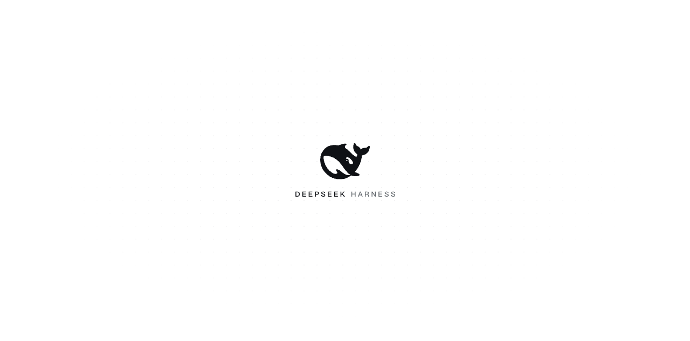

# dsh-toolkit

**给 DSH 配上一套工具箱——外观、自动化、设备、通知和桌宠，一次安装，九个模块分别开关。**

---

DSH 插件集合：把常用的界面定制与工具管理放进 **设置面板**，把移动设备放进 **右侧栏**，把会话进展带到 **系统通知与桌面窗口**。安装一个聚合包后，可在插件管理中按需启停每个模块。

- 🎨 **启动动画与外观**：三款启动动画，原始 DSH / Codex / 大海蓝鲸 / 昼夜流光四套主题，浅色、深色与跟随系统分别选择；设置页可直接预览。
- 🗂️ **归档管理**：搜索已归档会话，按工作区查看，恢复或永久删除。
- 🌐 **浏览器自动化**：浏览器工具、环境自检与可选的自动决策，复用 `agent-browser` 和 Chrome / Chromium。
- 🧠 **决策服务**：为自动化提供结构化模型判断，集中配置连接与额度。
- 📱 **移动设备**：设备发现、实时画面和控制面板，在 DSH 右侧栏查看与操作手机。
- 🔌 **Skills & MCP**：管理技能文件与 MCP 服务，查看连接状态、导入配置，并按服务器筛选工具。
- 🔔 **会话通知**：完成、失败、等待回答或需要授权时提醒，分别配置声音，点击通知返回对应会话。
- 🐾 **桌面宠物与灵动岛**：四套内置形象，悬浮宠物与屏幕顶部灵动岛分别开启；查看真实会话进展、发送消息、停止运行或返回工作台。

**目录**：[界面预览](#界面预览) · [安装](#安装) · [使用](#使用) · [工作原理](#工作原理) · [已知边界](#已知边界) · [开发与验证](#开发与验证) · [更多文档](#更多文档) · [License](#license)

## 界面预览

启动动画 · 跃浪成标的最终画面（设计预览）



三款动画各自按固定时长播放，设置页顶部使用实际启动场景预览。仓库也保留了可单独打开的设计演示：

| 经典描摹 | 跃浪成标 | 鲸跃归海 |
| --- | --- | --- |
| [描线 → 填色 → 字标](docs/boot/demo-boot.html) | [跃出海面 → 收成 Logo](docs/boot/demo-morph.html) | [跃出海面 → 再入水](docs/boot/demo.html) |

## 安装

当前支持从本地仓库构建后安装。以下步骤不要求将九个模块分别安装，也不依赖尚未发布的 npm 包。

### 从源码准备

需要 **Node.js ≥ 20** 与 **pnpm 11.28.5**：

```sh
git clone https://github.com/j62268781-alt/dsh-toolkit.git
cd dsh-toolkit
pnpm install
pnpm build
```

构建会为聚合包的九个模块生成 Host、Client 和运行资源。请保留整个仓库目录；本地安装会使用这里的工作区依赖。

### DSH 桌面端

在 DSH 中请助手安装**构建后的仓库根目录**，例如：

> 请把 `/absolute/path/to/dsh-toolkit` 安装为当前 DSH profile 的插件包，并启用聚合包。

安装完成后，在插件管理中可以看到 **DSH 工具箱**及九个组件的独立开关。只开启需要的功能即可；桌面宠物与灵动岛还需要在自己的设置页中分别开启，初始均关闭。

Host 代码更新后需重启 DSH，再刷新页面加载 Client。桌面端 profile 由桌面应用管理，不使用 `dsh plugin --profile desktop` 命令修改。

### 命令行管理的 profile

对自行通过 CLI 启动的 profile，可以安装同一份已构建的本地目录：

```sh
dsh plugin --profile web add /absolute/path/to/dsh-toolkit
```

将 `web` 替换为你的 CLI profile 名称。安装后重启对应 DSH 实例并刷新页面。

只需要单个模块时，也可将已构建的 `packages/<module>` 目录作为独立 bundle 安装，包名见下表。

### 已经安装了九个独立模块？

先备份目标 profile 的清单、锁文件和配置，再让 DSH 助手完成切换：**安装暂不启用的聚合包 → 移除九个独立 bundle 安装项 → 启用聚合包**。聚合包保留相同的模块条目 ID，已有配置与组件开关继续生效。这条本地切换路径已经验证。

避免同时启用聚合包和同名模块的独立 bundle，以免重复声明。若升级来源是更早的 `shell-kit` 单体配置，请使用下文的[旧配置迁移](#旧配置迁移)。

## 使用

设置面板是主要入口；模块开关在插件管理中，每项功能的偏好在对应设置页中。

| 模块 | 入口 / 用途 | 独立包名 |
| --- | --- | --- |
| 启动画面 | 设置 → 启动动画 | `dsh-toolkit-boot` |
| 桌面主题 | 设置 → 外观 | `dsh-toolkit-theme` |
| 归档管理 | 设置 → 已归档的会话 | `dsh-toolkit-archived` |
| 浏览器自动化 | 设置 → 浏览器 | `dsh-toolkit-browser` |
| 结构化判断 | 设置 → 决策 | `dsh-toolkit-judgment` |
| 移动设备 | 设置 → 移动设备；右侧栏实时画面 | `dsh-toolkit-mobile` |
| Skills / MCP | 设置 → Skills & MCP | `dsh-toolkit-skills-mcp` |
| 会话通知 | 设置 → 通知 | `dsh-toolkit-notification` |
| 桌面宠物 | 设置 → 桌面宠物 | `dsh-toolkit-pet` |

### 启动动画与外观

- **三款动画**：经典描摹、跃浪成标、鲸跃归海，分别固定为 **2.4 / 2.9 / 4.5 秒**。选择后保存，无需设置播放时长；系统减少动态效果偏好会生效。
- **明暗与主题分开选**：浅色 / 深色 / 跟随系统控制明暗，原始 DSH / Codex / 大海蓝鲸 / 昼夜流光控制主题。
- **Codex** 有自己的工作区布局；其他三款基于 DSH 原始布局。切换主题会同步回收上一款主题的样式。
- **设置导航图标**：八个工具箱设置页的侧边栏图标由各自模块提供，一个模块一个图标（启动=火箭、浏览器=地球、判断=天平、通知=铃铛、桌宠=爪印、外观=调色盘、归档=收纳盒、Skills & MCP=插头），并直接覆盖原生齿轮。图标用 `currentColor` 绘制，跟随侧边栏该行的文字色与高亮，不需要按主题各配一套；想换形状就改对应模块客户端里注册时的那一个图标名。
- **大海蓝鲸与昼夜流光** 的动态场景只出现在主工作区的空白新会话中。昼夜流光跟随本地时间变化，已有会话保持阅读界面。

### 检查桌面更新

在 DSH 桌面端打开设置，点击右上角 **「更多设置操作」（…）→「检查更新」**，进入原生更新流程。菜单会随状态显示检查、下载或安装操作，进行中会暂时禁用以避免重复触发。普通浏览器中此项禁用，需回到 DeepSeek Harness 桌面应用检查更新；同一菜单中的「打开配置文件」仍可使用。

### 会话通知

在「设置 → 通知」调整提醒时机、提醒类型和声音。完成、失败、等待回答、需要授权分别控制；系统通知权限也在这里检查和申请。

窗口在后台或隐藏时用系统通知；**窗口正在前台使用时改为右上角的提醒卡片**——点卡片一定切到对应会话（失败会在卡片上说明原因），8 秒后自动消失，也可以用 `Esc` 关掉。已归档的会话会先恢复再打开。系统权限与桌面环境会影响实际弹出和窗口激活效果，详见[通知模块说明](docs/notification/README.md)。

### 桌面宠物与灵动岛

1. 打开「设置 → 桌面宠物」，选择内置形象。
2. 开启「显示悬浮宠物」或「显示灵动岛」，也可先点「准备桌面运行时」。首次使用需要下载 Electron；准备失败时页面会显示原因并提供重试。
3. 按需调整宠物大小、会话气泡宽度、灵动岛收起尺寸，以及是否在其他显示器上同步显示。

两种窗口共用所选形象，开关和尺寸分别保存。悬浮宠物可以拖动；多个显示器上的灵动岛共享会话内容，各窗口的悬停与展开独立响应。

窗口由插件自动启动和管理，无需手动运行另一款桌宠软件。批准与问题会引导回原会话处理。详细配置、运行方式与资源许可见[桌面宠物说明](docs/pet/README.md)。

## 工作原理

一个仓库提供一个聚合 bundle 和九个模块包：

```text
src/modules/<module>/   模块源码
src/host/               公共 Host 逻辑
src/client/             公共 Client 逻辑与样式
packages/<module>/      各模块包的入口、清单与构建产物
cordis.patch.yml        聚合包声明九个模块条目
```

**Host** 在 Harness 进程中运行，负责工具、配置与鉴权路由；**Client** 运行在 DSH 页面里，注册设置页、侧栏和交互。组件开关同时管理该模块的 Host 与 Client。

根目录的 `pnpm build` 会把模块所需的 Host 依赖、Client bundle 和资源生成到各包的 `lib` 中。源码集中维护，无需拆成九个 Git 仓库；不要直接编辑这些构建产物。

**依赖由用途区分**：DSH 核心包以可选 peer 声明，由宿主提供；Skills/MCP 使用运行依赖 `yaml`，桌宠使用 `@electron/get` 与 `extract-zip` 准备 Electron。浏览器与设备控制使用外部 CLI，安装工具箱不会替你安装所有外部工具。

**桌宠运行在独立的 Electron 辅助进程中**，通过本机回环连接接收 Host 状态，由辅助进程创建透明置顶窗口。它随插件退出，不修改 DSH 安装文件，也不依赖 DSH 私有 Electron IPC。

## 已知边界

| 功能 | 需要的环境 / 当前边界 |
| --- | --- |
| 浏览器 | 需要 `agent-browser` CLI 和 Chrome / Chromium；环境自检可用于排查缺失项。 |
| 移动设备 | 需要 `mobilecli`；Android 还需要 `adb`，iOS 需要设备代理与设备端授权。 |
| Skills / MCP | 需要目标运行时、技能目录权限及宿主 Loader / MCP 服务；第三方服务器的连接和授权仍受其自身条件影响。 |
| 系统通知 | 需要系统授权和连接着的 DSH 页面；操作系统可能限制通知弹出、声音和点击后的窗口激活。 |
| 桌面宠物 | Host 必须运行在有图形桌面的本机；远程或无图形 Host 无法把窗口显示到浏览器所在的电脑。 |

桌宠首次准备运行时需要联网，也可配置 `electronPath` 或 `DSH_TOOLKIT_ELECTRON_PATH` 使用已有 Electron。macOS 通过 AppKit 的真实安全区域数据识别刘海并定位灵动岛；其他平台和无刘海显示器使用独立的屏幕顶部胶囊布局。平台对置顶、全屏空间和多显示器的处理可能不同，需按实际系统验证。

当前桌宠使用四套内置形象，未接入官方在线 Petdex、语音输入或触觉反馈。插件加载前已经等待的批准、历史失败状态无法完整恢复；新产生的批准和问题会显示为待处理。点击返回工作台需要有连接着的 DSH 页面接收导航事件。

## 开发与验证

在仓库根目录运行：

```sh
pnpm install
pnpm verify
```

| 命令 | 用途 |
| --- | --- |
| `pnpm build` | 构建 Host、Client 与九个模块包 |
| `pnpm typecheck` | TypeScript 检查 |
| `pnpm test` | 运行测试 |
| `pnpm check` | 检查模块与包的契约 |
| `pnpm build:check` | 只检查构建产物是否最新 |
| `pnpm verify` | 构建、类型检查、契约检查、测试与产物一致性检查 |

修改源码后重新构建，Host ESM 改动需重启 DSH。测试默认跳过真实设备发现；真实 Skills/MCP patch 测试需要显式设置 `SMP_REAL_PATCH`。

### 旧配置迁移

从旧单体配置升级时，先对**目标 profile 的配置文件**生成预览：

```sh
pnpm migrate:config /absolute/path/to/profile/cordis.patch.yml
```

确认预览后再写回：

```sh
pnpm migrate:config /absolute/path/to/profile/cordis.patch.yml --write
```

命令不会自动选择当前 profile。写入前会创建带时间戳和 UUID 的备份；已有模块配置优先，旧总开关状态会分别保留到九个模块。冲突别名或不安全的 YAML 结构会拒绝自动迁移。

旧 root 覆盖会保留并设为禁用；由于新 bundle 不再插入旧 `shell-kit` 行，宿主可能对这条遗留覆盖提示 `entry not found`，不影响新模块行。从九个独立 bundle 切换到聚合安装不需要运行此迁移。

## 更多文档

| 文档 | 内容 |
| --- | --- |
| [启动动画说明](docs/boot/README.md) | 三款动画、设计来源、时长与减少动态效果 |
| [通知模块说明](docs/notification/README.md) | 提醒行为、权限、声音与接口契约 |
| [桌面宠物说明](docs/pet/README.md) | 配置字段、辅助进程、桌面环境与素材许可 |
| [模块包目录](packages/) | 九个独立包的清单与入口 |
| [Judgment 类型契约](src/modules/judgment/host/contract/index.ts) | `dsh-toolkit-judgment/contract` 导出的类型与服务契约 |

## License

代码采用 [MIT](LICENSE)。桌宠内置的四套程序绘制素材各自声明为 **CC0-1.0**；未使用 Qoder 官方宠物美术或 `dsh-pet` 的受限素材。
