# weixin-clawbot 功能流程

微信私聊 ↔ DSH 会话桥。一句话：**消息先进过滤链，再过「审批 / 命令 / 对话」三分支；对话分支始终只驱动一条会话，这条会话是「接管的、恢复的、或新建的」。**

图里的每个判定，都对应 `src/modules/weixin-clawbot/host/` 里的一个函数；容易含糊的四处（谁持有 agent、什么时候换会话、正在回答时能不能换、审批算谁的）在文末有定论表。

## ① 消息入口与过滤

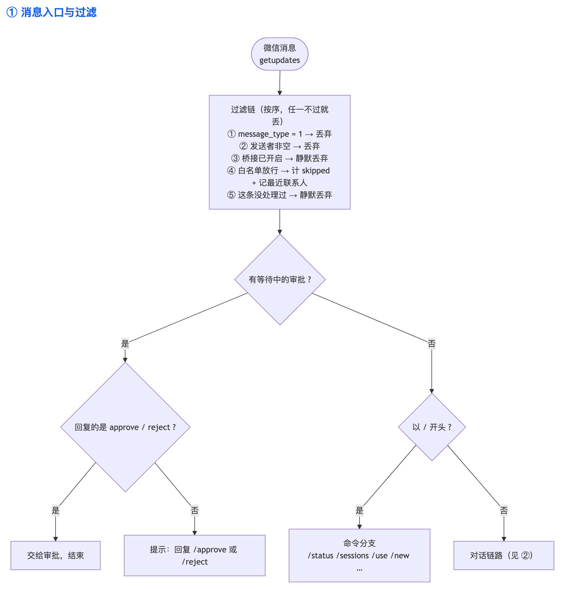

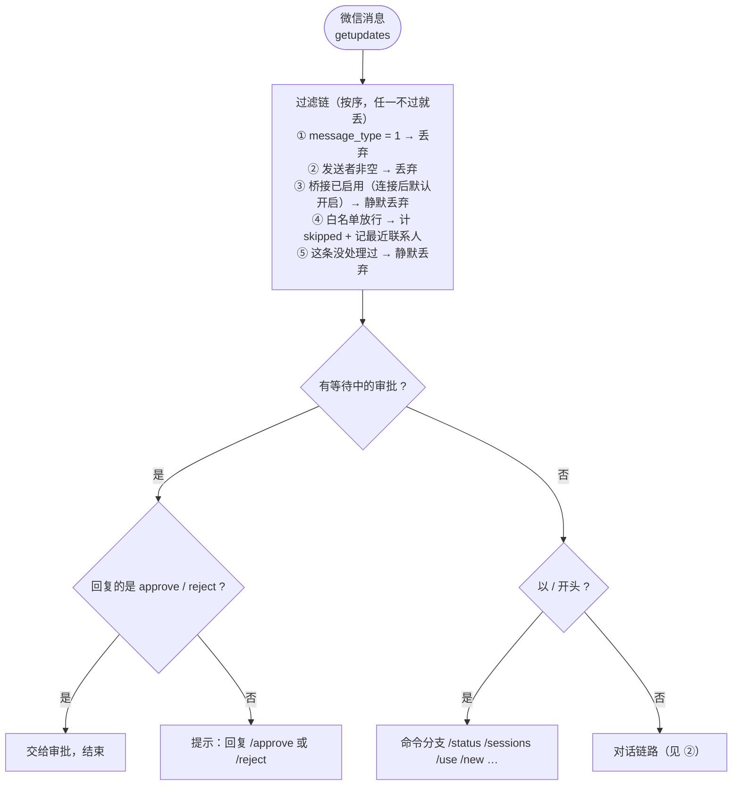

## ② 对话链路：跑一轮并回微信

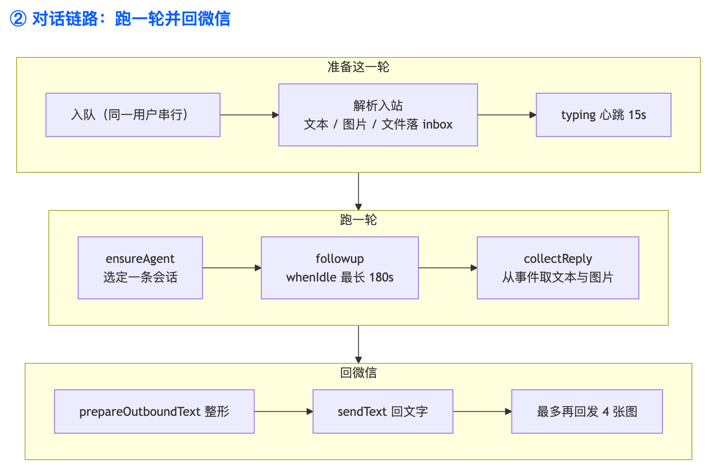

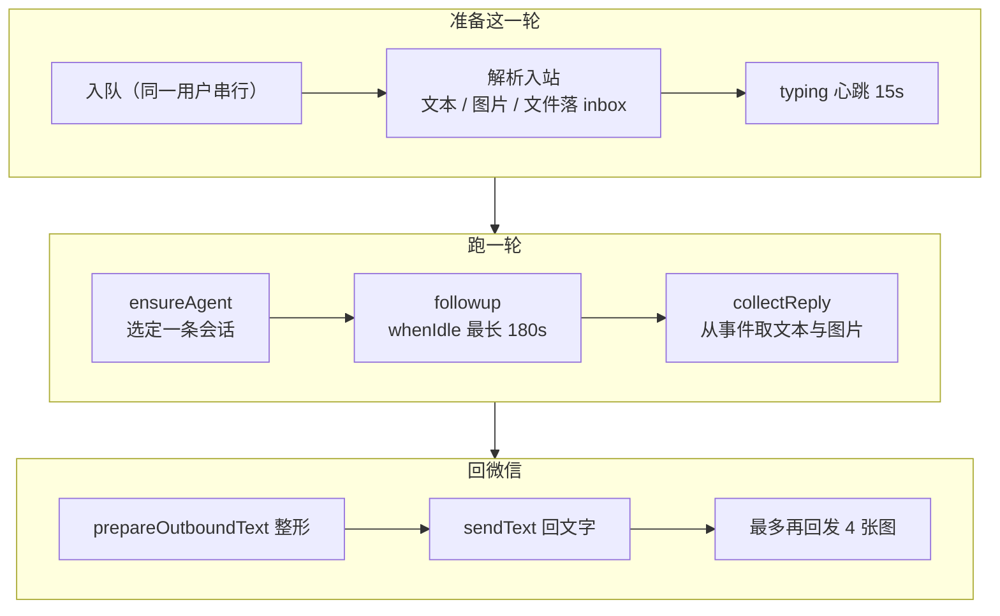

## ③ 会话归属：接管 / 恢复 / 新建

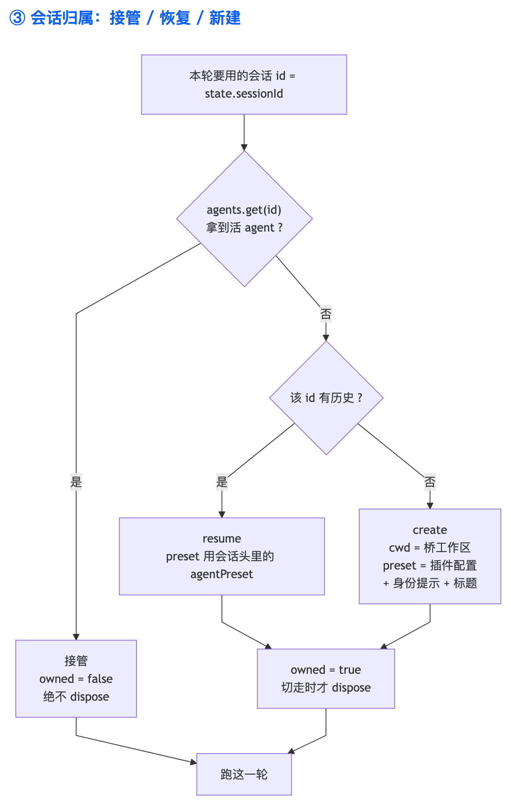

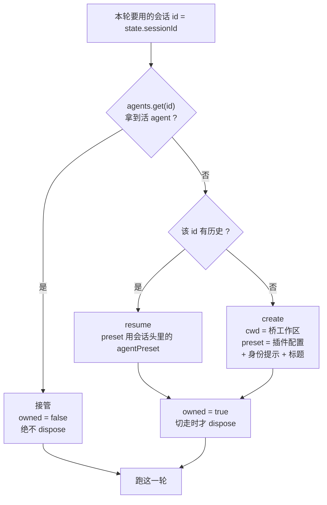

## ④ 选会话与切换：`/use` 与 `/new`

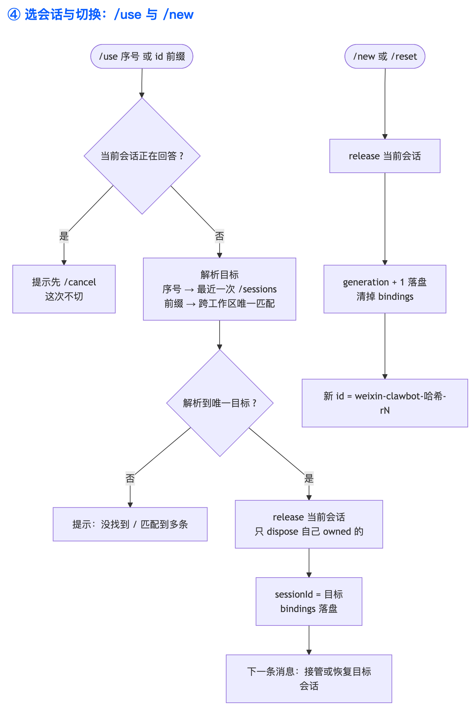

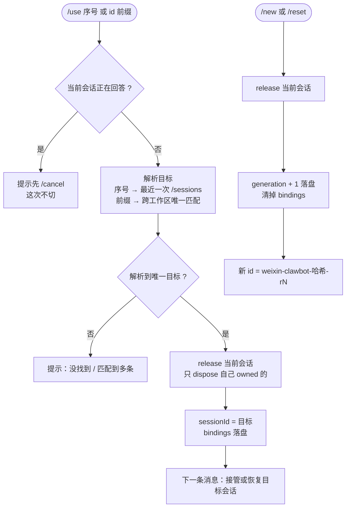

## ⑤ 审批转发时序

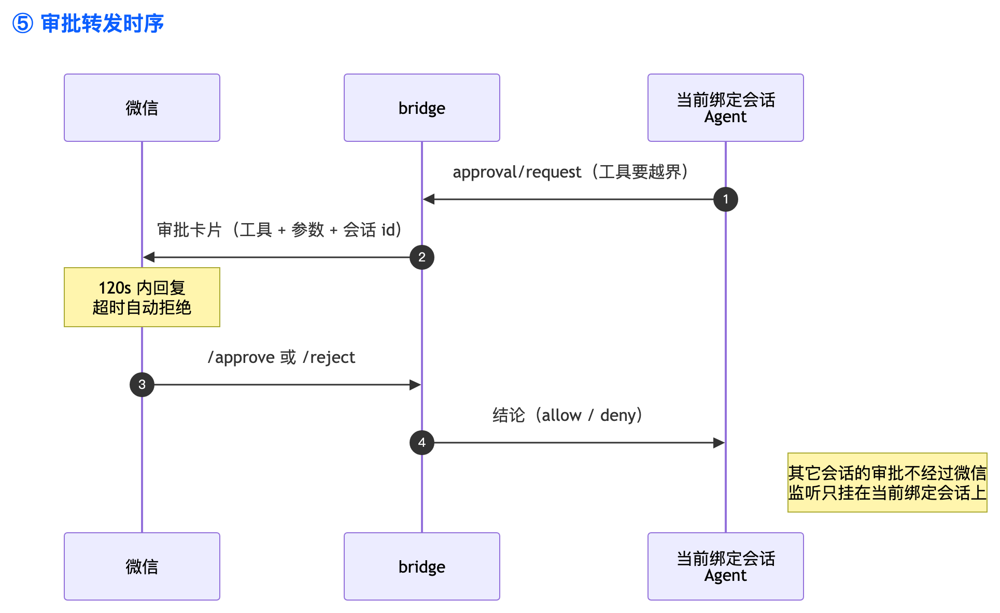

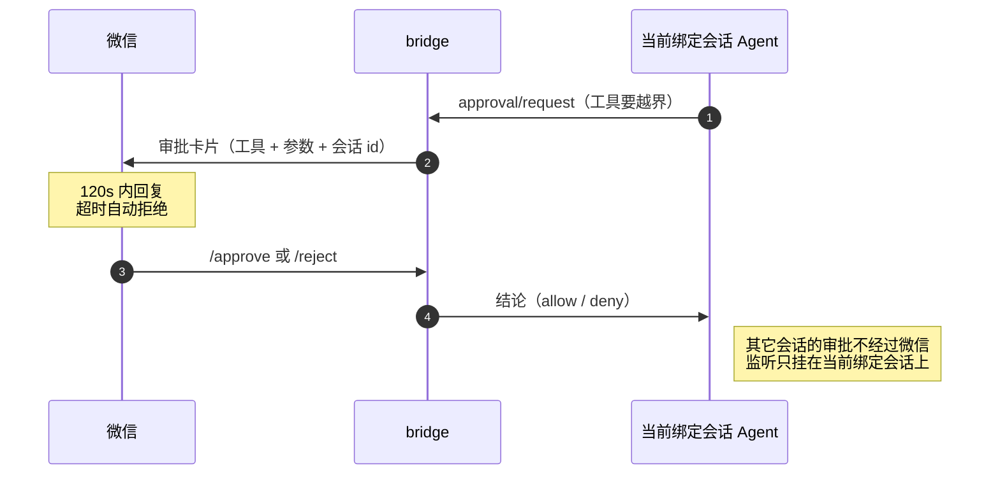

## ⑥-a 选择门禁：还没绑定会话时怎么处理

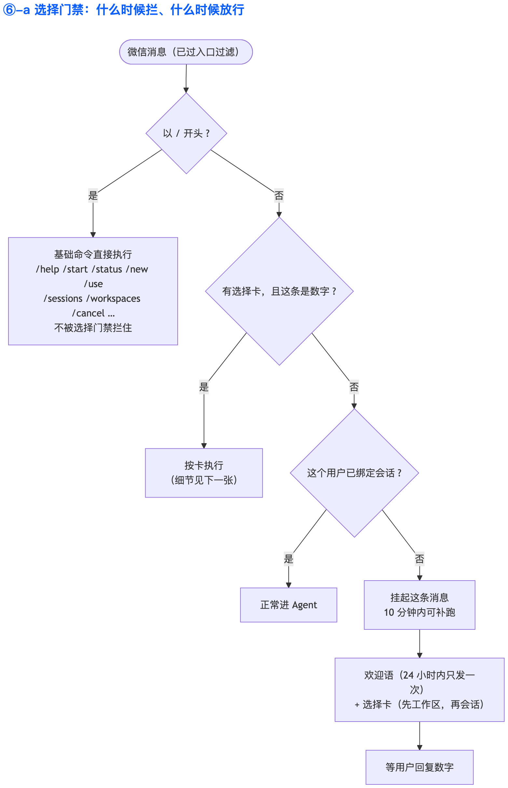

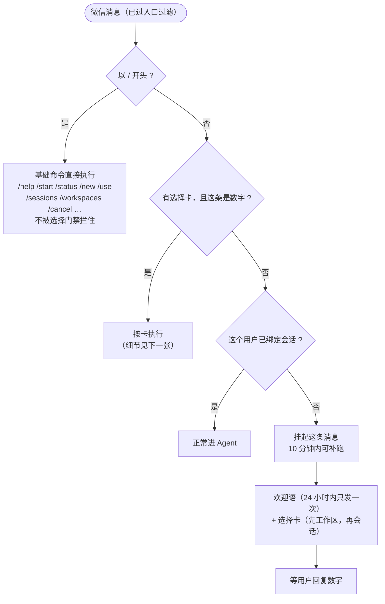

- 门禁只拦**拿不准该用哪条会话**的普通消息；命令一律放行，所以第一次用的人发 `/help`、`/status`、`/new` 都不会被卡住。
- 挂起不是丢弃：选完会话后 bridge 会先回一句「接着回你刚才那条：」，再把这条消息补跑掉。
- 超过 10 分钟没选，挂起作废（避免几天后突然冒出个旧问题）；对话里会说明，重新发一句即可。
- 打招呼按人记时间戳，**24 小时内不会重复发**；`/start` 随时可以重新要一张选择卡。

## ⑥-b 选择卡怎么点：先选工作区，再选会话

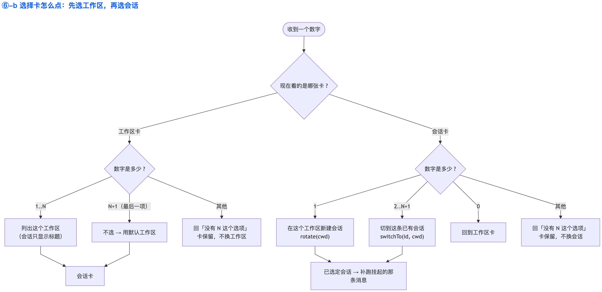

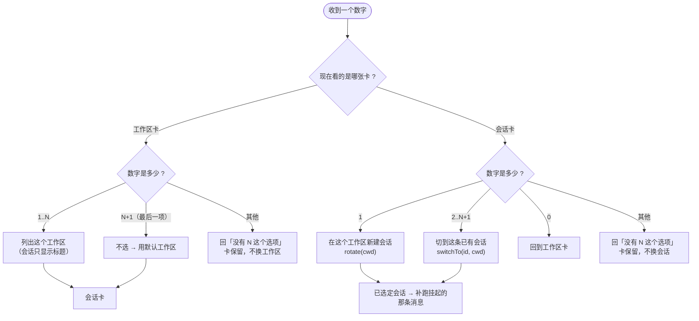

两张卡的实际样子：

```
先选工作区（回复序号）
1. dsh-toolkit（当前）
2. dsh-plugins
3. 不选，用默认工作区（~）

请选择会话（回复序号）
工作区：dsh-toolkit

1. 新建一条会话
2. 修一下登录跳转
3. 微信桥接的命令设计
0. 换个工作区
```

- **先工作区、再会话**：两步走，每一步的序号都少，卡也短。工作区只显示**目录名**（家目录显示 `~`），会话只显示**标题**——不带长路径、不带 `session_id`。
- 工作区卡的最后一项是「不选，用默认工作区」：不想挑就直接跳过（默认工作区就是桥启动时的工作区，通常是 `~`）。
- 会话卡里 **`1` 固定是新建**，选 `0` 退回工作区卡。该工作区的会话**全列出来**（不截断），所以序号就是卡片上的顺序。
- 一个工作区都没登记时（全新环境），跳过工作区卡直接给默认工作区的会话卡。
- 输入非数字（比如直接说话）不会当成选项，仍按普通消息处理——所以卡在屏幕上时照样可以问别的。

## 五处容易含糊的判定，这里是定论

| 问题 | 结论 | 代码 |
| --- | --- | --- |
| agent 到底谁持有？ | `agents.get(id)` 能拿到活 agent 就说明 GUI（或别处）在跑，我们**只接管、绝不 dispose**；只有我们自己 `resume`/`create` 出来的才在切走时 dispose | `conversation.js` `ensureAgent` / `release` |
| 什么时候换会话？ | **只有** `/use` 和 `/new` 会改 `sessionId`。普通消息永远用当前绑定，不会因为「你提到另一条会话」就跳走 | `conversation.js` `switchTo` / `rotate` |
| 正在回答时能切吗？ | 不能。`/use` 会先看 `agent.status !== 'idle'`，忙就提示先 `/cancel`，避免把跑到一半的回合掐掉。同一用户的普通消息则排队串行 | `conversation.js` `isBusy` / `enqueue` |
| 第一次用的人会被拦住吗？ | 只有「拿不准用哪条会话」的普通消息会被门禁拦下并挂起；命令一律放行。卡 10 分钟有效，选完立刻补跑 | `bridge.js` `handleMessage` / `handleChoice` / `replaySuspended` |
| 欢迎语会天天来吗？ | 不会。按人记 `greeted` 时间戳，24 小时内只发一次；`/start` 主动要卡时才重发 | `picker.js` `GREET_INTERVAL_MS` |
| 审批算谁的？ | 只挂**当前绑定会话**的 `approval/request`：切换时 `detachApproval`，接管时补挂。GUI 里其它会话的审批不会进微信，`/approve` 也批不到它们 | `conversation.js` `attachApproval` / `detachApproval` |

## 命令一览

| 命令 | 作用 |
| --- | --- |
| `/status` | 通道 + 桥接状态（收到 / 回复 / 跳过、当前会话、是否手动绑定） |
| `/where`、`/info` | 当前工作区、会话名、`session_id`、权限预设、会话来源、运行状态 |
| `/workspaces`、`/ws` | 工作区列表（序号 + 标题 + 路径 + 会话数） |
| `/sessions`、`/ls` | 当前工作区最近的会话（带序号与 `session_id`）；`/sessions all` 按工作区分组 |
| `/start` | 重新发一张选择卡（先选工作区，再选会话或新建） |
| `/use <序号>`、`/use <id前缀>`（`/switch`、`/bind`） | 切到已有会话：GUI 开着就接管，只有历史就恢复 |
| `/new`、`/reset` | 另开一条新会话（id 变成 `…-rN`），并清掉绑定 |
| `/cancel`、`/stop` | 中止当前回合 |
| `/approve`、`/reject` | 答复待审批（120s 超时自动拒绝） |
| `/help` | 命令帮助 |

## 落盘状态（`~/.dsh/weixin-clawbot/<account 哈希>.json`）

`enabled`、`policy`（open / allowlist）、`allowFrom`、`cursor`（getupdates 游标）、`contexts`（每用户 `context_token`）、`seen`（消息去重）、`generations`（`/new` 次数）、`bindings`（`/use` 或选择卡选中的 `session_id`）、`greeted`（每个用户上次打招呼的时间戳）。

重启后：`bindings` 还在 → 仍指向同一条会话；活 agent 已不在 → 自动 `resume`，历史接得上。

## 已知限制

- `getupdates` 是消费型接口，**同一 token 同时只能有一个消费者**；桌面端开着桥，CLI/官方插件那边就收不到。
- 语音只取微信给的转写文本；单条正文超过 8000 字节会截断（全文落 `.dsh-weixin`）。
- 单次回答等待上限 180s，超时会 `cancel` 并回提示；图片文件只回发最近 4 张。
- 一个用户同一时间只支持一个待审批（第二条会自动拒绝并告知）。
- 选择卡只在 10 分钟内有效；挂着不选，之后发的消息会重新弹卡并重新挂起。
- 选择卡按「工作区 → 会话」两层展开，会话卡把该工作区的会话全列出来，因此工作区里会话过多时卡会很长；这种场景直接用 `/sessions` + `/use <序号|id前缀>` 更快。
- 改完 host 代码需要重启桌面端才生效。
